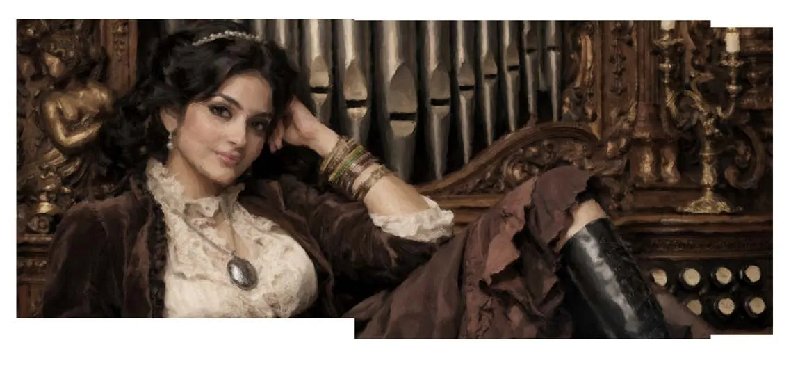

# Действующие лица

## Независимые / возможные союзники

### Леди Саанви Немо

*42 года, капитан «морского чудовища» «Наутилуса»*

Причина, по которой сыщики ввязываются в дело, и ключ к развязке сценария.

Внешность: Саанви Немо — вдова, уже три года как потерявшая мужа, Томаса; после его смерти она пустила состояние своей бенгальской семьи на поход мести против Судоходной компании Марша. Одевается по викторианской моде, с украшениями, напоминающими о её южноазиатском происхождении. Всегда носит медальон с портретом мужа.

Черты: ей свойственна строгая властность, обычная для капитанов того времени; она неизменно вежлива и говорит короткими отрывистыми фразами. Требует уважения и ждёт, что её приказы будут исполнены. Кто бросает ей вызов, становится жертвой холодной ярости, что тлеет в ней со дня исчезновения мужа.

Зацепки для отыгрыша: Немо обходится с людьми справедливо, но превыше всего ставит уничтожение Судоходной компании Марша.

### Аника Орбан

*33 года, старпом и главный механик «Наутилуса»*

Член команды «Наутилуса», возможный союзник сыщиков или препятствие для них.

Внешность: невысокая и хрупкая, Аника Орбан носит рабочую одежду, удобную для ручной и часто грязной работы, которую она выполняет, обслуживая «Наутилус».

Черты: угрюма; если и улыбается, то лишь с сарказмом или презрением. Предана леди Немо больше всех на свете и втайне мечтает, чтобы между ней и её овдовевшим капитаном были возможны романтические отношения.

Зацепки для отыгрыша: Орбан — старпом «Наутилуса» и первый член команды, с кем сыщики, скорее всего, будут иметь дело.

### Касьель Мершан и Филиппа Дукас

*29 и 30 лет, члены команды «Наутилуса»*

Типичные матросы из команды «Наутилуса».

Внешность: высокий, долговязый и бородатый — и низенькая, отважная и свежая лицом: Касьель Мершан и Филиппа Дукас — воплощение поговорки о том, что противоположности сходятся, а отсутствующая кисть Мершана и отсутствующий глаз Дукас лишь подчёркивают это. Носят практичную одежду команды «Наутилуса».

Черты: всегда вместе и дополняют друг друга. Мершан говорит медленно и веско, Дукас — огонь. Оба — бывшие моряки Судоходной компании Марша, признанные негодными к дальнейшей службе после увечий, полученных на работе.

Зацепки для отыгрыша: Мершан и Дукас — главные собеседники сыщиков из команды «Наутилуса».

## Прочие персонажи

### Сент-Джон Кофилд и Уиннифред Хемлок

*Страховые оценщики «Скарлетт и Мур»*

Поверенные, которые просят сыщиков помочь положить конец слухам о «морском чудовище».

### Фрэнсис Гилман

*Капитан грузового судна «Кастро»*

Капитан судна, на борту которого сыщики в конце концов встречают «Наутилус».

### Зэдок Аллен

*Старпом грузового судна «Кастро»*

Старпом грузового судна, на которое сыщики садятся в акте II; бывший сослуживец Томаса Немо и возможный источник сведений.
