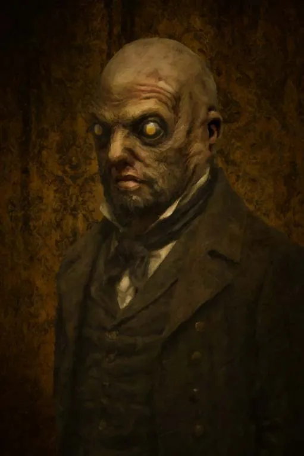

## Противники

### Томас Немо

*45 лет, превратившийся глубоководный*

Пропавший муж леди Немо.

Внешность: Томас Немо завершил превращение в глубоководного. Он чуть ниже других глубоководных и всё ещё сохраняет некоторые внешние черты своего человеческого прошлого — клочковатую чёрную растительность на лице и глаза, в которых светится узнавание того, кем он был когда-то. На шее у него висит медальон с выпуклой буквой «N» и портретом его бывшей жены.

Черты: внешне он ведёт себя как прочие глубоководные — бессмысленно разрушает и бесчинствует. Если напомнить ему о его человечности, он может разговаривать на ломаном, гортанном английском (родном языке) или хинди (родном языке жены) — и внять доводам.

Зацепки для отыгрыша: он появляется в кульминации сценария, и его столкновение с женой может решить, удастся ли сыщикам успешно завершить расследование (и выжить).

# Как вовлечь сыщиков

Четыре судна потеряны за четыре месяца. После второго крушения газета «Новости Лондона» приписала катастрофы океанскому «морскому чудовищу», и все газеты — от «Пост» до «Таймс» — подхватили историю, гадая о природе этого существа. С гибелью четвёртого судна страсти накалились до предела: многие корабли отказываются выходить в Атлантику. К сыщикам обращаются представители страховых оценщиков «Скарлетт и Мур» с просьбой изучить дело, уладить шум и, если удастся, раскрыть правду об этих крушениях. Если нужен дополнительный повод, кто-то из сыщиков мог потерять друга на одном из пропавших судов.

Сыщики, которые обычно следят за новостями, знают о сообщениях о «морском чудовище», наводящем ужас на Атлантику. Перескажите, зачитайте или отдайте игрокам **раздатку 1: «Газетная статья»**.

# Вступительная сцена: страховые оценщики «Скарлетт и Мур» к вашим услугам

К сыщикам обращаются мистер Сент-Джон (произносится «Синджин») Кофилд и мисс Уиннифред Хемлок из фирмы страховых оценщиков «Скарлетт и Мур» по поводу четырёх потопленных грузовых судов. Встрече может предшествовать официальная переписка — или пара поверенных может просто появиться на пороге у сыщиков.

Кофилд и Хемлок представляются сотрудниками своей фирмы, которую акционеры побудили разобраться в крушениях и добиться, чтобы новых страховых требований больше не поступало. Опыт сыщиков в делах эзотерических делает их идеальными субподрядчиками для расследования истории с «морским чудовищем».

Если сыщики захотят глубже разобраться в мотивах агентов, они могут попробовать проверку Психологии или другого навыка. Обычный успех заставит поверенных признаться, что они действуют также по поручению некоторых министров правительства и Адмиралтейства. Только трудный или чрезвычайный успех откроет, что за их мотивами кроются и другие тайны — а именно что они действуют и по поручению Судоходной компании Марша.
