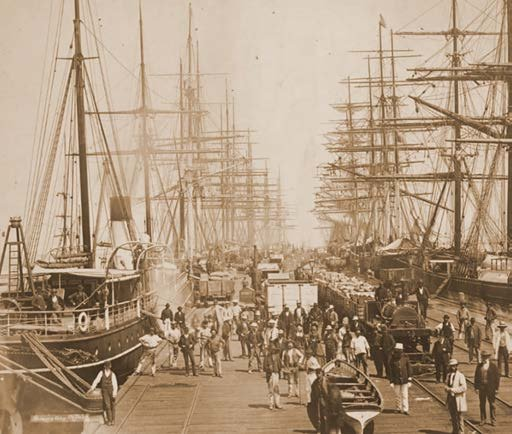

# Акт I. «Морское чудовище» наводит страх на морскую торговлю

В **акте I** сыщики начинают расследовать недавнюю череду гибели судов. Они узнают, что все четыре потопленных судна принадлежали Судоходной компании Марша и ею же эксплуатировались. Акт I заканчивается, когда сыщики решают — или получают указание — пересечь Атлантику на грузовом судне, чтобы самим узнать правду о «морском чудовище».

## Судоходная компания Марша

Расследовать череду потерянных грузовых судов сыщики могут по-разному. Они могут изучить сведения о потопленных судах или расспросить выживших членов команд. Могут поговорить с зоологами о том, чем могло бы быть «морское чудовище». Как бы сыщики ни вели расследование, они должны узнать как минимум основные сведения ниже (даже при проваленных проверках навыков), а дополнительные сведения дают успешные проверки навыков или проверки с трудным или чрезвычайным успехом.

> **Основные улики**
>
> - Описанное выжившими «морское чудовище» поначалу приняли за кашалота.
> - Выжившие вспоминают жестоко зазубренное рыло, будто у огромной рыбы-меч.
> - Все потопленные суда принадлежали одной компании — Судоходной компании Марша.
> - Следующее грузовое судно компании Марша, которое должно выйти в ближайшие дни, — «Кастро», идущий в Нью-Йорк из Портсмута.

<!-- -->

> **Дополнительные улики**
>
> - Кроме размеров и шипов, у «морского чудовища» описывают ярко-жёлтые фасеточные глаза, как у насекомого (на деле — иллюминаторы «Наутилуса»).
> - У Судоходной компании Марша репутация надёжной фирмы: задержек и потерь груза у неё гораздо меньше, чем у конкурентов.
> - Судоходную компанию Марша основал Обед Марш, торговец из Новой Англии с оккультным прошлым и связями среди контрабандистов.
> - Судоходная компания Марша щедро жертвует Эзотерическому ордену Дагона, и её акционеры — в основном члены этой общины. Дальнейшее расследование показывает, что Эзотерический орден располагается в Новой Англии и пользуется дурной славой из-за якобы нехристианских оккультных обрядов.
> - До недавней череды крушений единственным известным публике несчастьем Судоходной компании Марша на море была потеря подававшего надежды моряка, капитана Томаса Немо, три года назад. Сыщики, копнувшие глубже, могут узнать, что после него осталась вдова, Саанви, но любые сведения о ней обрываются через несколько месяцев после исчезновения мужа. Больше никаких её следов, судя по всему, нет.
> - «Кастро» принадлежит Судоходной компании Марша.
> - Истинный пункт назначения «Кастро» держат в тайне: по документам судно идёт в Нью-Йорк, а на самом деле направляется в приморский городок Иннсмут в округе Эссекс, штат Массачусетс.

Эти улики должны убедить сыщиков, что нужно отправиться на одном из судов через Атлантику и увидеть «морское чудовище» своими глазами. Если сыщики с трудом приходят к этому выводу, к ним может напрямую обратиться представитель Судоходной компании Марша (капитан Фрэнсис Гилман, см. акт II), которому владельцы компании рассказали о сыщиках и их расследовании. При необходимости Кофилд и Хемлок от имени страховых оценщиков «Скарлетт и Мур» добавят денег для поощрения.
