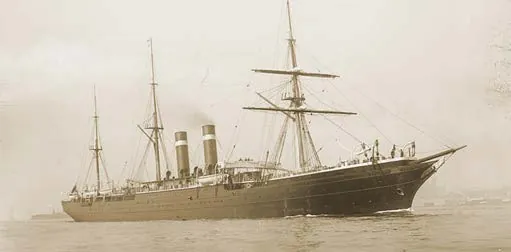

# Акт II. Все на борт «Кастро»

В **акте II** сыщики плывут на трансатлантическом пароходе Судоходной компании Марша. У них будет возможность пообщаться со странной командой судна, а в конце концов — встретиться лицом к лицу с «морским чудовищем», когда нападёт «Наутилус». Акт II заканчивается гибелью «Кастро» и спасением сыщиков «Наутилусом».

## «Кастро»

«Кастро» — грузовое судно постройки «Вирджинской судостроительной компании»; его команда — пять офицеров и 25 матросов. Судно везёт строительное оборудование и тайно — запас из трёх морских мин на случай, если ему встретится «морское чудовище». Переход через Атлантику, по расчётам, займёт 9–10 дней. За это время сыщики могут пообщаться с командой, в том числе с капитаном и старпомом, или заняться разными делами. Переходите к разделу «Нападение «морского чудовища»», когда это будет драматичнее всего, или когда сыщики удовлетворят своё любопытство, или когда каждый из них займётся одним делом.

## Разговор с капитаном Фрэнсисом Гилманом

Капитан Гилман, коротко поприветствовав сыщиков на борту, больше не станет искать их общества. Успешная проверка Психологии показывает, что он нарочно их избегает. Если же его припереть к стенке, от вопросов он не уклоняется, хотя, чтобы он открыл что-то из нижеследующего или всё, могут понадобиться успешные проверки Убеждения, Красноречия или Запугивания (капитана Гилмана не очаровать).

- Хотя официально «Кастро» идёт в Нью-Йорк, на самом деле он направляется в Иннсмут, штат Массачусетс. Секретность должна была сбить с толку того, кто стоит за гибелью судов.
- Гилман невысокого мнения о своём старпоме — пьянице, которому нельзя доверять; он советует сыщикам не разговаривать с Алленом.
- Гилман отказывается гадать о причине крушений. Если на него надавить, он просто заметит, что у моряков буйное воображение. Проверка Психологии показывает, что это неправда: на самом деле Гилман, как и прочие моряки, верит, что на Судоходной компании Марша лежит проклятие.
- Гилман носит непонятный религиозный символ из переплетённых звёзд. Если спросить Гилмана или успешно пройти проверку Оккультизма, выяснится, что это символ Эзотерического ордена Дагона.
- Гилман знает, что «Кастро» везёт морские мины, но полагается на то, что окольный курс судна убережёт их от беды.
- Капитан Гилман может также сообщить многое из того, что сыщики, возможно, не узнали, ведя собственные изыскания в акте I (см. «Судоходная компания Марша», с. 55).

## Разговор со старпомом Зэдоком Алленом

Сыщики могут подойти к старпому Зэдоку Аллену (или он сам к ним подойдёт). Аллен уже несколько лет ходит в рейсы Судоходной компании Марша (в том числе служил под началом капитана Томаса Немо) и повидал много странного. Пережитое не прошло для него даром, и Аллен пристрастился к выпивке. Он охотно предаётся воспоминаниям и отчаянно ищет общества людей, не подвластных Ордену Дагона. Подходящие проверки навыков (например, Обаяния, Убеждения, Психологии) могут разговорить Аллена, и он поделится частью сведений ниже или всеми.

- По словам Аллена, Судоходную компанию Марша держит в руках религиозный культ, известный как Эзотерический орден Дагона.
- Аллен поступил в Судоходную компанию Марша по просьбе капитана Томаса Немо, капитана торгового флота и бывшего офицера Королевского индийского флота.
- Аллен боготворит Томаса Немо как настоящего моряка и человека чести.
- Томас Немо исчез во время рейса через Атлантику, который Аллен пропустил из-за «болезни» (на деле он был мертвецки пьян).
- Аллен считает, что Томас Немо собирался разоблачить порочные дела Судоходной компании Марша, и Марш избавился от него в море. Своими подозрениями он поделился с женой Томаса Немо.
