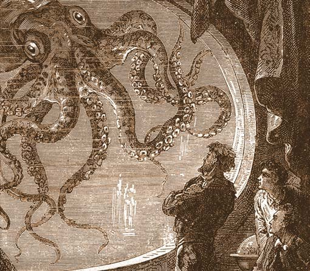

- Сброс одной или нескольких морских мин из трюма «Кастро» — для этого нужно управиться с грузовым краном судна. «Наутилус» это не уничтожит, но может серьёзно повредить корабль (что скажется на дальнейших отношениях сыщиков с его командой и капитаном).

Переходите к следующему разделу, как только сыщики сделают свои действия, или когда «Наутилус» снова ударит «Кастро», уничтожив его.

# Спасены «Наутилусом»?

Если сыщикам не удалось добраться до шлюпок, гибель «Кастро» оставляет их в ледяных водах посреди Атлантики. Сыщики должны описать, как они держатся на воде. Просто плыть — нужна успешная проверка навыка (Плавание). Если держаться за обломки (при успешной проверке Удачи), это даёт бонусную кость или позволяет сыщикам вместо этого пройти трудную проверку СИЛ или ВЫН. Чтобы забраться в шлюпку или на плавающий груз, нужна проверка Лазания или трудная проверка СИЛ, а сыщики, уже находящиеся в безопасности, могут бросать товарищам верёвки или спасательные круги (при успешных проверках Метания). Сыщики, проваливающие соответствующую проверку, не тонут автоматически, но получают 1d6 урона от усталости и переохлаждения.

Почти час уцелевшие сыщики дрейфуют, пока неподалёку (возможно, прямо под ними) из воды не поднимется металлическая громада. Сыщики должны понять, что «морское чудовище» на самом деле — подводный корабль. Все сомнения развеиваются, когда из люка показывается моряк. Это Аника Орбан, старпом «Наутилуса». Орбан явно относится к сыщикам с недоверием, и им могут понадобиться успешные проверки Обаяния, Красноречия или Убеждения, чтобы убедить её в своих намерениях — и в том, что они не в сговоре с семейством Маршей и его судоходным делом (или хотя бы ему не сочувствуют). Провал этой проверки даёт штрафную кость во всех дальнейших разговорах с Орбан. Пока же она лишь замечает, что «Маршами от них не пахнет», и забирает их внутрь.

> **Примечание для Хранителя**
>
> Игроки могут спросить, знакомы ли их сыщики с самим понятием подводной лодки. Сыщики могут пройти проверку Истории или подходящей Науки, чтобы вспомнить о применении такого судна в Гражданской войне в Америке или о недавних опытах с паровыми подводными лодками во Франции. Успешные проверки, однако, подтверждают, что ничего сравнимого с «Наутилусом» по размеру и мощи не существует.

# Акт III. «Наутилус»

В **акте III** сыщики оказываются на борту «Наутилуса» и получают возможность познакомиться с командой, в особенности с её капитаном, леди Немо. Как и на «Кастро», их пребывание на «Наутилусе» жестоко прерывает нападение глубоководных во главе с превратившимся мужем леди Немо, Томасом. Акт III заканчивается тем, что сыщикам снова нужно спасаться, — но на этот раз корабль уже под водой!

## Леди Немо и её команда

Тёплого приёма на борту «Наутилуса» сыщики не получают. Их спасение не было задумано, и их ближайшая судьба зависит от того, насколько полезными (или интересными) они сумеют себя показать. Старпом Аника Орбан устраивает предварительный допрос, едва сыщики оказываются внутри «Наутилуса», требуя назвать имена, род занятий и цель. Орбан стремится собрать как можно больше сведений для своего капитана и не церемонится, добывая их. Каковы бы ни были ответы, она отправляет сыщиков в карцер — «пока капитан не решит их судьбу».

В карцер сыщиков ведут Касьель Мершан и Филиппа Дукас, двое членов команды. Насколько грубо их будут гнать по кораблю, зависит от самих сыщиков: те, кто не поднимает шума, могут идти сами. Это возможность осмотреться и собрать сведения о «Наутилусе» и его команде. Отдайте игрокам **раздатку 3: «Схема «Наутилуса»»**. Пока сыщиков ведут с носа корабля, от мостика, в кормовой карцер, они могут пройти разные проверки навыков, чтобы узнать часть сведений ниже или все:
