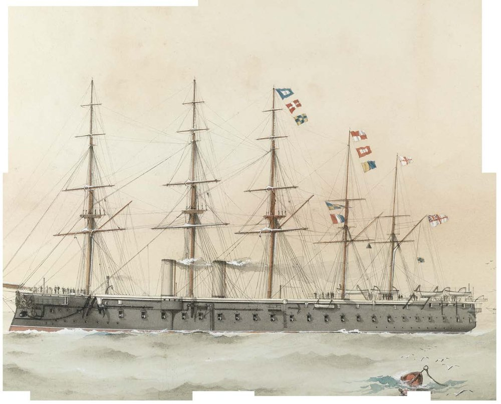

снова начнёт медленно погружаться. При трудном успехе корабль сильно повреждён, но его можно спасти, а главное — он держится на плаву, и ему не грозит немедленное затопление. Чрезвычайный успех означает, что корабль, хотя и сильно повреждён, остаётся на ходу и пригоден к плаванию (по крайней мере на поверхности океана).

# Спасение

Сумели ли сыщики вывести «Наутилус» или воспользовались спасательными капсулами — они избежали почти верной смерти. Как только «Наутилус» или спасательная капсула сыщиков выходит на поверхность, глубоководные бросают погоню (хотя, если «Наутилус» снова начнёт тонуть, они могут вернуться). Если «Наутилус» остаётся на ходу, сыщики могут добраться на нём до берега — возможно, с помощью леди Немо или старпома Орбан. Иначе через несколько часов сыщиков подбирает корабль Её Величества «Беллерофон», посланный Адмиралтейством раз и навсегда покончить со слухами о «морском чудовище».

# Подведение итогов

По возвращении в Лондон страховые оценщики «Скарлетт и Мур» выплачивают все причитающиеся деньги — при условии, разумеется, что сыщики не понесут свои находки в газеты. Сыщики могли также обрести новых друзей в лице леди Немо или её старпома Аники Орбан. Возможно даже — хотя и маловероятно, — что сыщики спасли сам «Наутилус» или подружились с превратившимся Томасом Немо, получив знакомого среди глубоководных.

Кроме того, если сценарий играется как часть большой кампании, сыщики могли узнать что-то новое о более широких делах Графини, в том числе найти улики, которые приведут их к следующему расследованию. Эти сведения могут исходить от Немо (если её спасли), от Орбан или от благодарных владельцев Судоходной компании Марша.

# Награды Рассудка

Сыщики, пережившие нападение на «Наутилус», получают 1d4 пункта Рассудка. Ещё по одному пункту Рассудка сыщики получают за каждое из следующего:

- леди Немо выжила;
- Аника Орбан выжила;
- узнали истинную судьбу мужа леди Немо, Томаса;
- раскрыли причину похода леди Немо против Судоходной компании Марша;
- узнали, кто тайный покровитель леди Немо.
