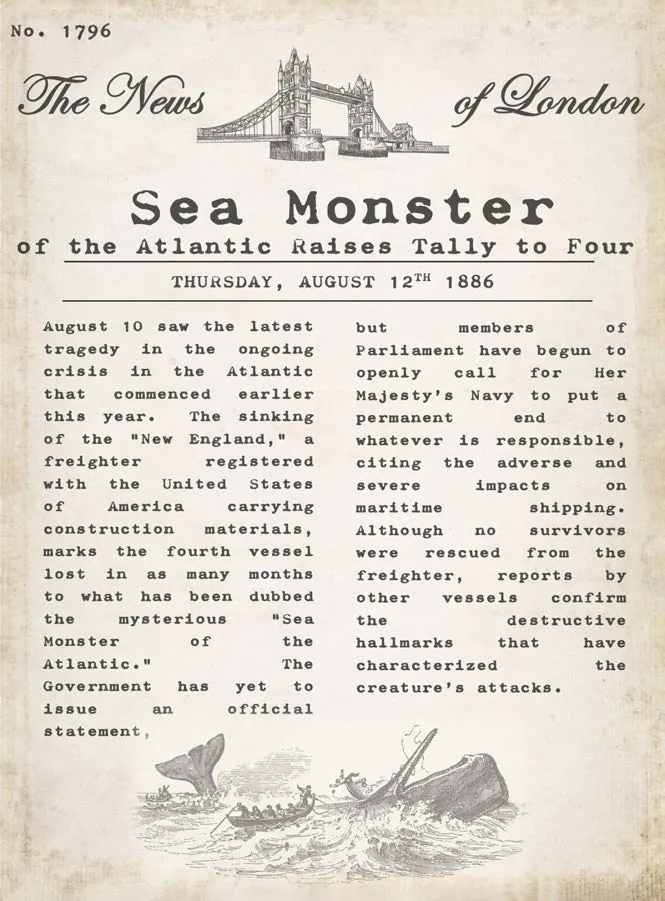

# Раздатки

## Раздатка 1

> **Раздатка «Леди Немо» 1: «Морское чудовище Атлантики довело счёт до четырёх»**
>
> № 1796
>
> **«НОВОСТИ ЛОНДОНА»**
>
> **Морское чудовище Атлантики довело счёт до четырёх**
>
> ЧЕТВЕРГ, 12 АВГУСТА 1886 ГОДА
>
> 10 августа случилась очередная трагедия в продолжающемся кризисе на Атлантике, начавшемся в этом году. Гибель «Новой Англии» — грузового судна, зарегистрированного в Соединённых Штатах Америки и шедшего со строительными материалами, — означает, что уже четвёртое судно за столько же месяцев погибло от того, что прозвали таинственным «Морским чудовищем Атлантики». Правительство пока не выступило с официальным заявлением, однако члены парламента уже открыто призывают военный флот Её Величества раз и навсегда покончить с тем, кто за этим стоит, ссылаясь на тяжёлый ущерб морской торговле. Хотя с грузового судна никого не спасли, сообщения с других судов подтверждают разрушительный почерк, отличающий нападения этого существа.

*Прим. перев.: на раздатке год 1886, а события главы — 1894 год («Новая Англия» потоплена 10 августа 1894 года по хронологии, с. 52). Оставлено как в оригинале.*
