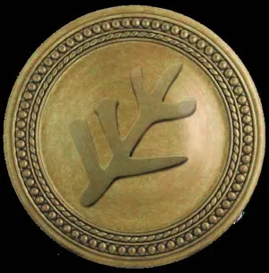
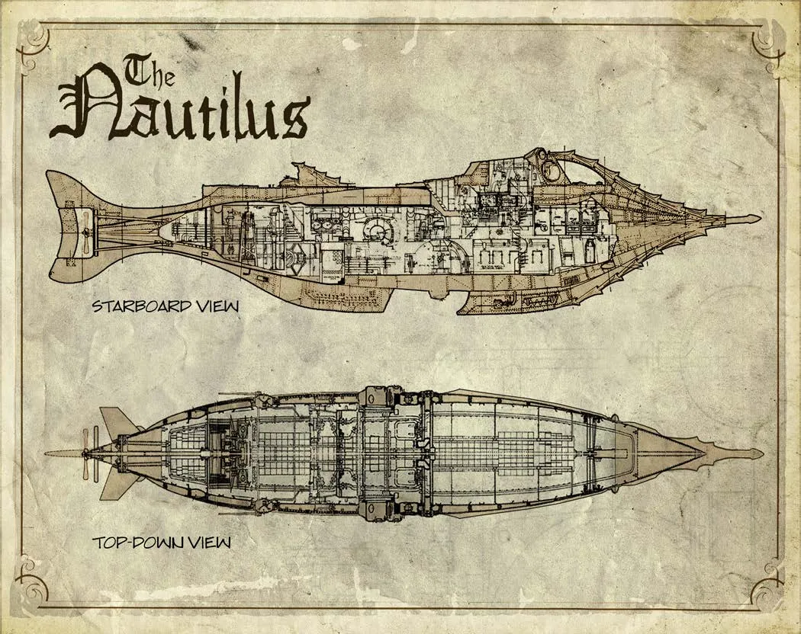

## Раздатка 2

> **Раздатка «Леди Немо» 2: безделушка**
>
> *Текста нет: на раздатке — бронзовый круглый жетон с бусинчатым ободком и выпуклым Знаком Старших богов (ветвь с пятью отростками) — оберег, который дарит старпом Зэдок Аллен.*

## Раздатка 3

> **Раздатка «Леди Немо» 3: схема «Наутилуса»**
>
> Надписи на чертеже: «The Nautilus» — «Наутилус»; «Starboard View» — вид с правого борта; «Top-Down View» — вид сверху.
