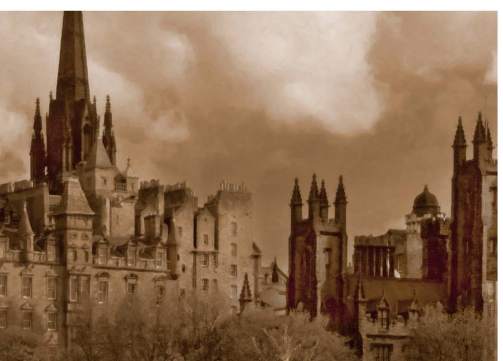

# Глава 5. Графиня (1897)

## Введение

20 июня 1897 года. Бриллиантовый юбилей королевы Виктории. Лондонские бульварные листки полны сочных сообщений о высокородной знати, ведущей себя очень, очень дурно, с туманными намёками на некую «графиню Б_____» в центре всего этого. На деле графиня Элизабет Батори и её Консорт, таинственная сущность Мифов, собирают силы и готовятся раз и навсегда свергнуть британскую монархию. Книжный клуб оказывается в центре внимания Графини, потому что владеет могущественным артефактом Мифов, которого она очень жаждет, — Несгоревшим сердцем Перси Биши Шелли. Графиня твёрдо решила заполучить сердце правдами и неправдами, кого бы ни пришлось уничтожить по пути.

## Предыстория

В начале XVII века венгерскую графиню Элизабет Батори политические враги ложно обвинили в том, что она пытала и убила сотни девушек и молодых женщин и купалась в их крови.

Запертая в своём замке, она тем не менее нашла способы изучать магические обряды: приняла обвинения врагов в дьявольщине и искала тайного наставничества у оккультных мастеров Восточной Европы. Со временем она соприкоснулась с сознанием сущности Мифов, не названной ни в одной из её книг. Эта сущность искала свободы двигаться в нашем мире, и её влекли гедонизм и бурные чувства Графини. Графиня назвала эту сущность своим Консортом. Позволив ей вторгнуться в свой разум, она приобрела черты, которые местный фольклор назвал бы вампирическими.

Около 1885 года Батори тайно приехала в Лондон и под разными именами, действуя из тени, поощряла тот мир, какой хотели создать она и её Консорт. Это и стало причиной событий первых трёх сценариев этой книги (главы 3–5).

В начале 1897 года, изучая древние книги Мифов, она узнала, что некоторые артефакты могут помочь ей открыть разум масс её посланию освобождения и что один такой артефакт хранится в Книжном клубе. В начале этого сценария она не знает точно, что это, но вместе с Консортом твёрдо решила найти и заполучить его.

*Прим. перев.: первые три сценария книги — главы 2–4 («Прятки с Хайдом», «Дитя Франкенштейна», «Леди Немо»); в оригинале номера глав сдвинуты на одну. Год этой главы в обзоре кампании (с. 5) — 1896, здесь — 1897.*
