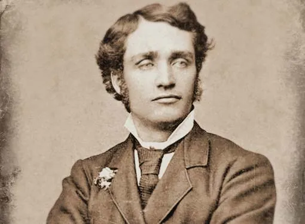

# Действующие лица

### Графиня Элизабет Батори

*337 лет, вампирическая распутница*

В облике Батори она выглядит невзрачно: мышино-русые волосы, бледный цвет лица. Однако её фарфоровая кожа совершенно безупречна, а ногти блестят, как зеркала. Днём её связь с Консортом ослаблена вмешательством Солнца. Ночью, когда ей доступна сила Консорта, она может принять облик одной из своих личин.

В облике графини Б____ она — королева скандального лондонского света. В этой личине она высокая, изящная, носит реки драгоценностей и буйно-яркие платья, а на её юном лице с пылающими щеками неизменная весёлая и дьявольская улыбка. У неё заметный акцент, который можно описать только как «иностранный».

В облике миссис Ифигении Блессинг она маленькая, пожилая и морщинистая, но весёлая и приятно-лукавая — шаркающая, милая, хрупкая дама в простом, но всё же модном зелёном платье с вуалью и с большим павлиньим пером на шляпе.

В облике слуги Джона Пейна она носит несколько потёртый красный или зелёный костюм, подобающий его ремеслу.

Миссис Блессинг носит розовые очки, скрывающие мерцание пламени за её глазами; кучер Джон Пейн по той же причине носит закопчённые очки. Графиня костров в своих глазах не скрывает.

Тусклых цветов она не носит ни при каких обстоятельствах.

Черты: её характер меняется вместе с личиной: в облике графини Б____ она жизнерадостна; в облике миссис Блессинг — скромна, но зорка и остроумна; в облике Джона Пейна — невозмутим и услужлив, всегда смотрит и слушает.

Зацепки для отыгрыша: она стояла за всеми предыдущими сценариями, а теперь так близка к своей конечной цели, что пускает в ход скрытность, хитрость и, в конце концов, силу, чтобы заставить Ужастиков дать ей то, чего она хочет.

Другие имена: миссис Ифигения Блессинг, графиня Б____, Джон Пейн, слуга.

### Доктор Алвар Кула

*43 года, врач*

Красив, с квадратной челюстью; близорук; высокий и широкоплечий, обычно с небольшими пятнами крови на рукаве — следами своей вполне почтенной дневной работы.

Черты: со всеми, кроме Графини и её любимых Любовников, он слишком резок и сух, чтобы быть обаятельным. По-настоящему оживает он только в её присутствии, но охотно обсуждает современные медицинские, научные и отчасти оккультные познания с любыми другими сведущими людьми.

Зацепка для отыгрыша: ученик врача, впервые применившего современные способы переливания крови, доктор Кула помогает Графине, забирая большие объёмы крови у добровольных доноров, чтобы те, кто желает слиться с Консортом, могли в ней купаться. Игроки могут заметить, что его имя похоже на «Дракула», — для персонажей это, конечно, ничего не значит, но это полезный ложный след. Если сыщики будут слишком долго заниматься доктором, Графиня успеет продвинуть свои планы, пока они отвлечены.

### Любовники

*возраст разный, слуги Графини*

Двое мужчин и женщина, чей видимый возраст разнится, но которые всегда выглядят прекрасными и полными жизни; одеты в яркие цвета и носят самую дорогую одежду, какую только можно достать.

Черты: они без ума от Графини и преданно следуют за ней десятилетиями или дольше. Глубоко затронутые Консортом, они обрели долю силы Графини. «Простое» человечество им неинтересно — разве что как младенцы, которых нужно поднять на более высокую ступень, или как игрушки, которые используют и выбрасывают по прихоти.

Зацепки для отыгрыша: они служат Графине защитниками и исполнителями её воли и сопровождают её на светских приёмах, следя, чтобы все предались разврату в высшей степени.

*Прим. перев.: возраст Графини здесь — 337 лет, в статблоке (с. 78) — 350.*
