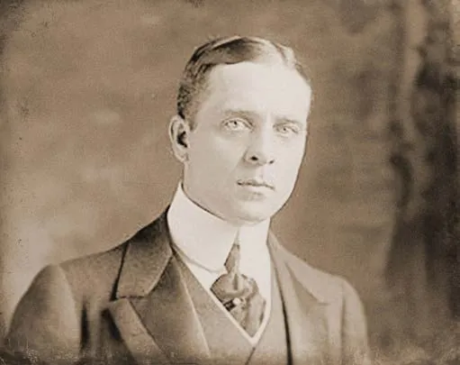
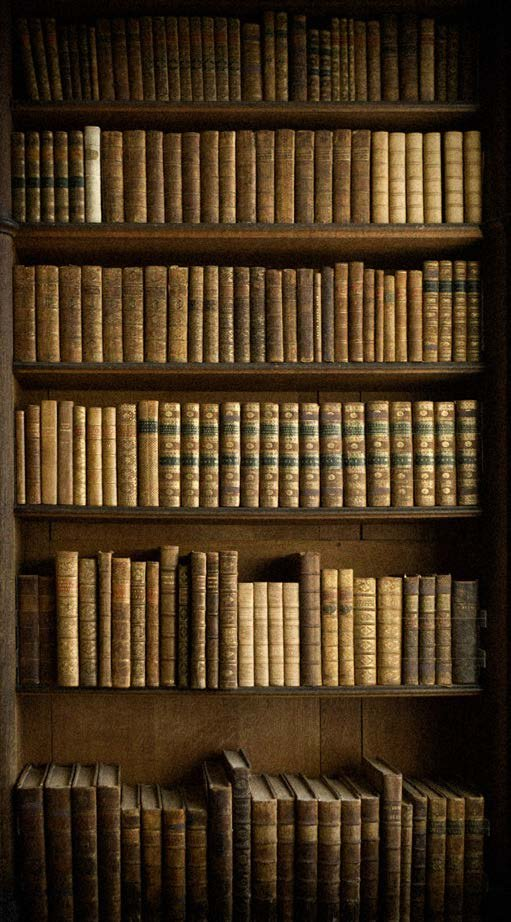

### Генри Криз

*35 лет, богатый щёголь*

Чопорный, благовоспитанный джентльмен из нуворишей. Высокий, красивый, одет дорого, но очень консервативно.

Черты: он мгновенно осознаёт своё положение в обществе относительно любого человека в комнате и, сообразно чину собеседника, либо подобострастен, либо пренебрежителен. Не нужно никакой проверки Психологии, чтобы увидеть, что он чудовищно неуверен в себе.

Зацепки для отыгрыша: он упекает свою жену Вирджинию в Хаммерсмитский институт, когда та позорит его, связав его имя со скандалом и распутством.

### Вирджиния Криз

*26 лет, несостоявшаяся Любовница Графини*

Юная и по-обычному хорошенькая, но, оказавшись в Хаммерсмитском институте, выглядит измождённой, и на ней видны следы побоев.

Черты: она страстно любит искусство и даже в заточении тянется к прекрасному и ко всему, что выражает свободу и радость.

Зацепки для отыгрыша: вечер, который она устраивает вместе с Графиней, даёт начало сценарию, а её кровавый побег из Хаммерсмита — ключевой поворот сюжета.

### Джек Уинслоу

*29 лет, управляющий Хаммерсмитским институтом для душевнобольных женщин*

Среднего роста, крупного сложения, с несколько растрёпанными чёрными волосами. Часто носит врачебный халат, хотя неясно, есть ли у него вообще какое-то медицинское образование.

Черты: ему очень хочется быть самым умным человеком в комнате, он всегда в курсе последних достижений науки и техники. Склонен разглагольствовать, полагая, что слушатели им очарованы.

Зацепки для отыгрыша: смотритель и несостоявшийся ухажёр Вирджинии Криз; в конце концов — жертва Графини.

# Как вовлечь сыщиков

После собрания и публичного чтения книги в Книжном клубе к сыщикам подходит Дэвид Вэнс (из «Пряток с Хайдом») (см. «Вступительная сцена»). Поднявшись по служебной лестнице в Скотленд-Ярде, теперь он поступил на службу в само правительство, на неопределённую должность, как-то связанную с тайной службой. Он пришёл поговорить о скандальных вечерах, о которых недавно писали лондонские газеты. Он описывает некоторые стороны этих вечеров, о которых публично не сообщалось, включая слухи о настоящих кровавых ваннах: гости купаются в ваннах, полных крови. Зная кое-что об истинной деятельности Ужастиков, он просит их расследовать эти вечера и выяснить, кто за ними стоит и не убили ли кого-нибудь на самом деле, чтобы добыть такие огромные количества крови.
