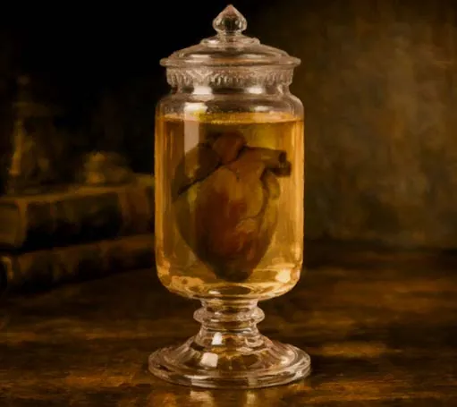
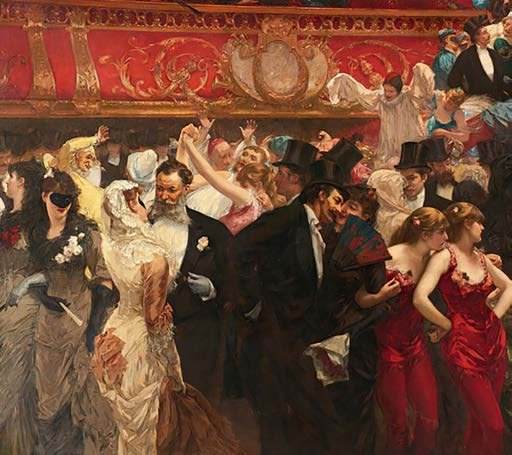

# Вступительная сцена

*20:00, 15 июня 1897 года*

Ужастики готовятся провести в Книжном клубе публичное чтение — читать будет немолодой ирландец, член клуба по имени Абрахам Стокер, а вещь — ничем не примечательные «Воспоминания об Уитби».

На чтение приходят многие завсегдатаи, в том числе все персонажи Хранителя, с которыми сыщики подружились в прежних приключениях. Привратник Суонсон, провожая каждого гостя в зал и показывая, где закуски и бар, незаметно разглядывает его и отмечает любые приметы. За несколько минут до начала чтения приходит Графиня в облике мисс Ифигении Блессинг.

Обычный тихий звук биения несгоревшего сердца Шелли в библиотеке — в зале его всегда нелегко расслышать — отзывается на приход мисс Блессинг, но мало кто из гостей, если вообще кто-то, это замечает. Трудная проверка Слуха в момент её прихода позволяет заметить, что сердце пропустило удар. Больше мисс Блессинг ничем не привлекает к себе внимания: она лишь осматривается в Книжном клубе и вежливо слушает Стокера, когда тот начинает читать.

Когда чтение подходит к концу и несколько преданных поклонников путевой литературы подходят к Стокеру поздравить его и докучать ему, к сыщикам подходит знакомое лицо. Дэвид Вэнс, держащий небольшую стопку сегодняшних бульварных листков, жестом зовёт компанию в гостиную, как сделал это, когда началось их прежнее дело 11 лет назад. У него простая белая визитная карточка с его именем и словами «Особый отдел».

# Акт I. Скандальный вечер

Газеты пишут о скандальном вечере в особняке в Ноттинг-Хилле, устроенном женщиной, известной лишь как «графиня Б_____». Гости вечера, ни один из которых в газете не назван, были одеты очень ярко и творили «немыслимое, о чём нам не пристало упоминать на этих страницах». Отдайте игрокам **раздатку 1**.

Вэнс тут же сообщает некоторые подробности, которых в статье не было. Вечер проходил в лондонском особняке Генри Криза и его юной хорошенькой жены Вирджинии. Обычно правительству до этого не было бы дела, но у Криза есть политические связи с оппозицией, а значит, для нужного человека этот скандал может стать и подспорьем, и угрозой. Кроме того, некоторые подробности вечера, не попавшие в газеты, особенно тревожны. Вэнс слышал, что на этом вечере люди купались в крови. Наверняка были и смерти?

> **Связи с готической биографией**
>
> Сыщики с биографией «знаток оккультного» могут сразу почувствовать, что напали здесь на след чего-то противоестественного. Сыщики же с биографией «отрицательное чувство: вожделение», напротив, могут взволноваться при упоминании распутства и увидеть в этом деле возможность потворствовать этой стороне своей натуры.

Если в этом скандале есть что-то… противоестественное… то Книжный клуб — как раз те, кто с ним справится. В конце концов, Вэнс знает, что у Книжного клуба есть опыт необычных происшествий, а у Клуба как раз достаточно сомнительная репутация, чтобы подобраться поближе к тому, что здесь происходит. Вэнс предлагает начать с визита в особняк Криза — и посмотреть, что удастся найти.

*Прим. перев.: здесь хозяйкой вечера названа графиня Б_____, а раздатка 1 (с. 80) называет хозяйкой дома миссис К____; здесь — «мисс Блессинг», на с. 68 — «миссис».*
