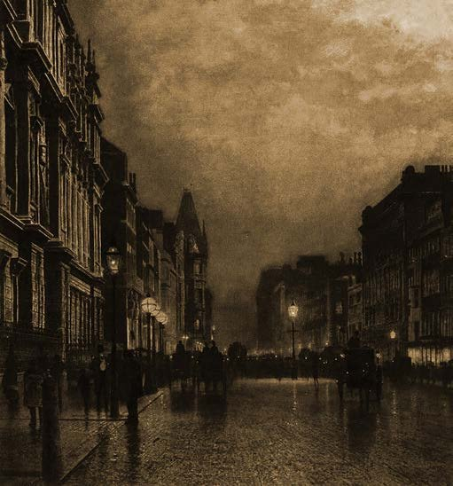
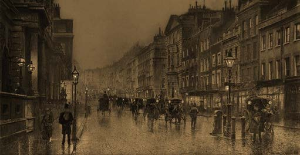

### Визит после нападения Графини

Если между разговором сыщиков с Генри Кризом и их поездкой в Хаммерсмитский институт проходит ночь или если они уходят, не забрав с собой Вирджинию Криз, Графиня наносит удар. Когда сыщики прибывают в институт или возвращаются туда, Графиня уже убила Уинслоу, освободила Вирджинию Криз и вырезала дюжину санитаров.

Расспросы констеблей Столичной полиции или любопытных соседей дают следующее:

- Кто-то видел, как около полуночи у дома остановилась карета, которой правил человек, подходящий под описание Джона Пейна. Другие извозчики его знают и подсказывают, что его часто можно застать выпивающим в пабе «Маринованное яйцо» в Ист-Энде.
- У кареты есть приметные знаки: пучки павлиньих перьев у сиденья кучера и маленькие разноцветные фонарики, висящие внутри. На каждой дверце вытиснен полумесяц.

Найдя карету и проследив за ней или порасспросив местных знакомых, которые могли её видеть, сыщики узнают адрес тайного убежища Графини: Пикадилли, 347. Если сыщикам удастся перехватить карету и поговорить с кучером, Джоном Пейном, тот будет отрицать, что знает что-либо о Графине. Разумеется, на самом деле он и есть Графиня, и ей наверняка будет интересно узнать побольше об этих людях, которые так ею интересуются… (см. «Визитная карточка Графини»).

Если Графиня освободила Вирджинию Криз, то в следующий раз, когда сыщики её увидят, она уже станет одной из Любовников.

Если сыщики не побывают в Хаммерсмите после нападения Графини, они всё равно узнают о нём на следующее утро из статьи, почти лишённой сенсационности, — вместе с другими скандальными выходками знати, бывшей на вечере Графини (см. **раздатку 2: «Нападение в Хаммерсмите»**). Раздатка описывает карету Графини, не называя владельца, так что сыщики могут идти по этому следу, даже если их не было на месте нападения.

*Прим. перев.: в самой раздатке 2 (с. 81) о выходках знати ничего нет.*

# Акт II. В погоне за Графиней

Познакомившись с некоторыми приближёнными Графини и увидев следы её деяний, сыщики, скорее всего, захотят попытаться её найти. Должно становиться всё яснее, что она представляет опасность для британского общества, хотя точная природа этой опасности, возможно, пока неясна. Сыщики могут даже в чём-то сочувствовать её делу, особенно если принадлежат к какой-нибудь ущемлённой группе викторианской Англии.

Ищут ли они её, чтобы остановить, чтобы узнать о ней больше или, быть может, чтобы присоединиться к ней, — пора найти Графиню.

## Визит в дом Графини

В акте I у сыщиков было несколько возможностей узнать адрес лондонского дома Графини. Они могли найти его в кабинете доктора Кулы (см. «Расспросы доктора Кулы») или выследить её карету (см. «Расследование в Хаммерсмитском институте»). Она живёт в сравнительно старом, но ухоженном и ярко выкрашенном особняке в фешенебельном районе Пикадилли.

Прислуги там, похоже, нет, кроме одной распутного вида молодой женщины. Она поклонница Графини, но, как и доктор Кула, вполне смертна. Той доли силы, что приходит с принадлежностью к Любовникам Графини, она не обрела. Если сыщики подойдут к двери, она откроет им в скандально неопрятной пародии на форму горничной. Если сыщики назовут себя или скажут, что они из Книжного клуба, она впустит их с оскорбительным равнодушием.

