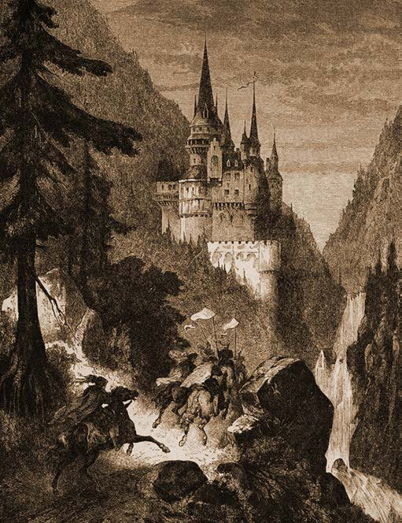
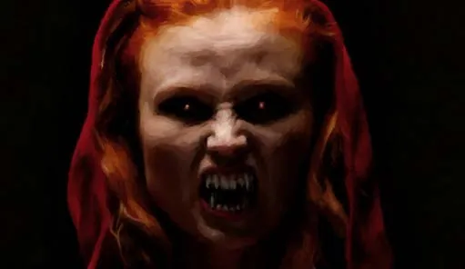

Разумеется, викторианский режим по-прежнему на месте, а общественные последствия скандалов последних дней могут в ближайшие месяцы вызвать непредсказуемые неприятности.

### Если Графиня преуспела

Сердце воплощает художественную страсть Великобритании. Символическая сила, которую оно даёт Графине, позволяет ей дотянуться до разумов сотен людей, а затем тысяч. В дни и недели после того, как она завладеет сердцем, всё больше знати, а затем и простых горожан предаются скандальным публичным бесчинствам и насилию, а Скотленд-Ярд всё беспомощнее пытается это остановить.

Репутации рушатся, а вскоре рушатся и жизни. Жертвы новоявленных «освобождённых» последователей Графини терпят позор и унижение. Иногда они жестоко мстят или же вовсе исчезают из общества.

Проходит всего несколько недель, и улицы начинают течь кровью. Все жаждут искупаться в крови и коснуться разума Консорта. Вскоре королеву свергают, и её место занимает Графиня. Долго ли сможет сопротивляться остальной мир, когда она стоит во главе одной из могущественнейших держав на Земле?

Если кто-то из сыщиков пережил визит Графини, они могут попытаться примкнуть к движению сопротивления, но шансы определённо не на их стороне.





# Персонажи Хранителя и чудовища

### Графиня

*350 лет, колдунья Мифов, вдохновившая современные истории о вампирах*

```stat
СИЛ 100   ВЫН 65    ТЕЛ 50    ЛВК 65    ИНТ 85
НАР 80    МОЩ 65    ОБР 85    Рассудок —    ПЗ 18
БкУ: +1d4   Комплекция: 1   Скорость: 9   ПМ: 13   Удача: 80

Примечание: характеристики даны для её истинного облика. В других, человеческих личинах её физические характеристики — как у обычного человека.

Атак за раунд: 2 (когти) или 1 (клык или любое оружие ближнего боя)
Ближний бой     65% (30/12), урон 1d4 + БкУ
Уклонение       50% (20/8)

Смена облика
Графиня может менять облик, чтобы быстрее двигаться или лучше сражаться. Превращение в тень или в волка стоит 1 ПМ:
• Тень (длится 30 секунд): бестелесна, не может воздействовать на физический мир, а он на неё, но может перемещаться по любой поверхности (например, по стене, картине, полу). Увидеть превращение — потеря 1d4 Рассудка.
• Волк (длится до 6 раундов): встреча с этим созданием первобытного кошмара — потеря 1d6 Рассудка. Укус: 1d8 + БкУ.

Другие способности
Завораживание: если она поймает взгляд цели и победит во встречной проверке МОЩ, жертва теряет 2+1d6 Рассудка и немедленно впадает в гедонистическое исступление на 1d4 раунда.
Полёт: она по желанию поднимается в воздух, но не может двигаться быстрее своей обычной Скорости.

Навыки: Антропология 40%, Оценка 30%, Обаяние 70%, Средства 70%, Мифы Ктулху 40%, История 55%, Иностранные языки 50% (английский, французский, немецкий, венгерский, другие по необходимости), Психология 65%, Слух 30%, Внимание 65%.
Заклинания: Связь с Консортом (обряд купания в крови, описанный в тексте сценария).
Другие имена: миссис Ифигения Блессинг, Джон Пейн.
```

*Прим. перев.: доли в оригинале не сходятся с процентами — «Ближний бой 65% (30/12)» и «Уклонение 50% (20/8)»; для 65% и 50% должно быть (32/13) и (25/10) — так в записи базы. ПЗ 18 при ВЫН 65 и ТЕЛ 50 (по правилам 11) — как в оригинале. Возраст здесь — 350 лет, в «Действующих лицах» (с. 68) — 337.*
