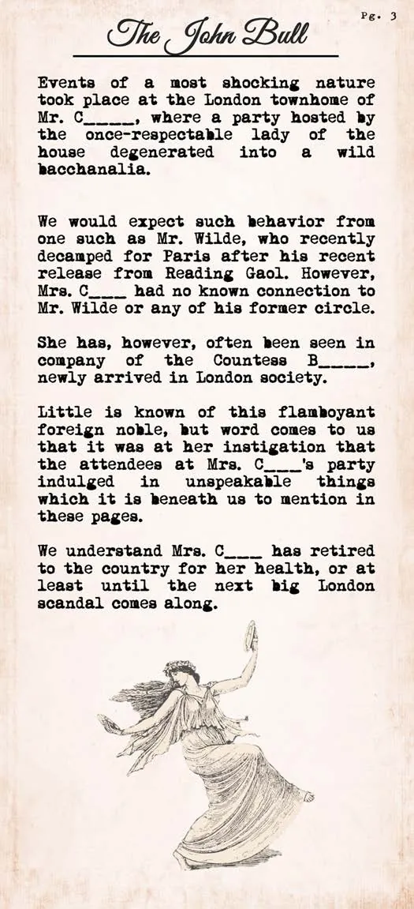

# Раздатки

## Раздатка 1

> **Раздатка «Графиня» 1: «Джон Булль»**
>
> **«ДЖОН БУЛЛЬ»** — с. 3
>
> События самого возмутительного свойства произошли в лондонском особняке мистера К_____, где вечер, устроенный некогда почтенной хозяйкой дома, выродился в дикую вакханалию.
>
> Такого поведения можно было бы ожидать от кого-нибудь вроде мистера Уайльда, который недавно перебрался в Париж, едва выйдя из Редингской тюрьмы. Однако миссис К____ не была известна никакими связями с мистером Уайльдом или кем-либо из его прежнего круга.
>
> Зато её часто видели в обществе графини Б_____, недавно появившейся в лондонском свете.
>
> Об этой яркой иностранной аристократке известно мало, но до нас доходят слухи, что именно по её наущению гости вечера миссис К____ предавались немыслимому, о чём нам не пристало упоминать на этих страницах.
>
> Как мы понимаем, миссис К____ удалилась в деревню поправить здоровье — или по крайней мере до следующего большого лондонского скандала.
