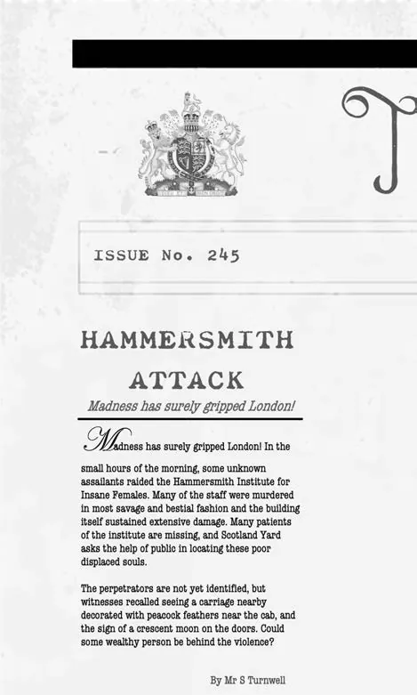

## Раздатка 2

> **Раздатка «Графиня» 2: «Нападение в Хаммерсмите»**
>
> ВЫПУСК № 245
>
> **НАПАДЕНИЕ В ХАММЕРСМИТЕ**
>
> *Безумие, несомненно, охватило Лондон!*
>
> Безумие, несомненно, охватило Лондон! Под утро неизвестные налётчики ворвались в Хаммерсмитский институт для душевнобольных женщин. Многие из служащих убиты самым диким и зверским образом, а само здание сильно повреждено. Многие пациентки института пропали, и Скотленд-Ярд просит публику помочь отыскать этих несчастных заблудших.
>
> Налётчики пока не установлены, но свидетели вспомнили, что видели поблизости карету, украшенную павлиньими перьями у козел, со знаком полумесяца на дверцах. Не стоит ли за этим насилием какой-нибудь богач?
>
> *Мистер С. Тернуэлл*
