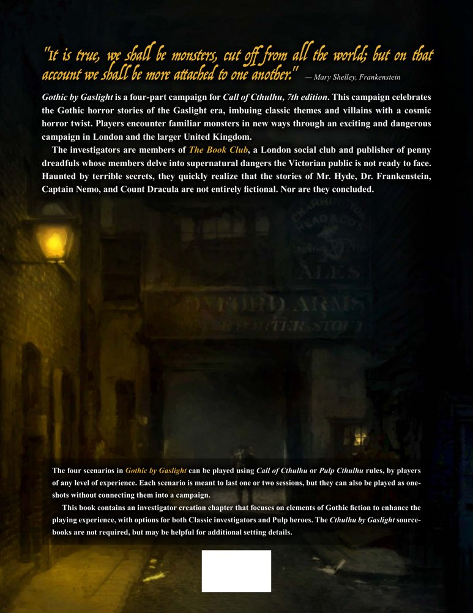

# Задняя обложка

> *«Да, мы будем чудовищами, отрезанными от всего мира, но именно поэтому мы будем сильнее привязаны друг к другу».* — Мэри Шелли, «Франкенштейн»

«Готика газового света» — кампания из четырёх частей для «Зова Ктулху» седьмой редакции. Эта кампания воспевает готические истории ужасов эпохи Газового света, придавая классическим темам и злодеям оттенок космического ужаса. Игроки по-новому встречают знакомых чудовищ в захватывающей и опасной кампании в Лондоне и по всему Соединённому Королевству.

Сыщики — члены Книжного клуба, лондонского клуба и издателя грошовых ужастиков, члены которого вникают в сверхъестественные опасности, к встрече с которыми викторианская публика не готова. Преследуемые страшными тайнами, они быстро понимают, что истории о мистере Хайде, докторе Франкенштейне, капитане Немо и графе Дракуле — не совсем вымысел. И они ещё не закончились.

Четыре сценария «Готики газового света» можно играть по правилам «Зова Ктулху» или Pulp Cthulhu, с игроками любого опыта. Каждый сценарий рассчитан на одну-две сессии, но их можно играть и как отдельные приключения, не связывая в кампанию.

В книге есть глава о создании сыщиков, посвящённая элементам готической литературы, которые обогащают игру, — с вариантами и для классических сыщиков, и для пульп-героев. Книги-источники «Cthulhu by Gaslight» не обязательны, но могут пригодиться для дополнительных подробностей о мире.
