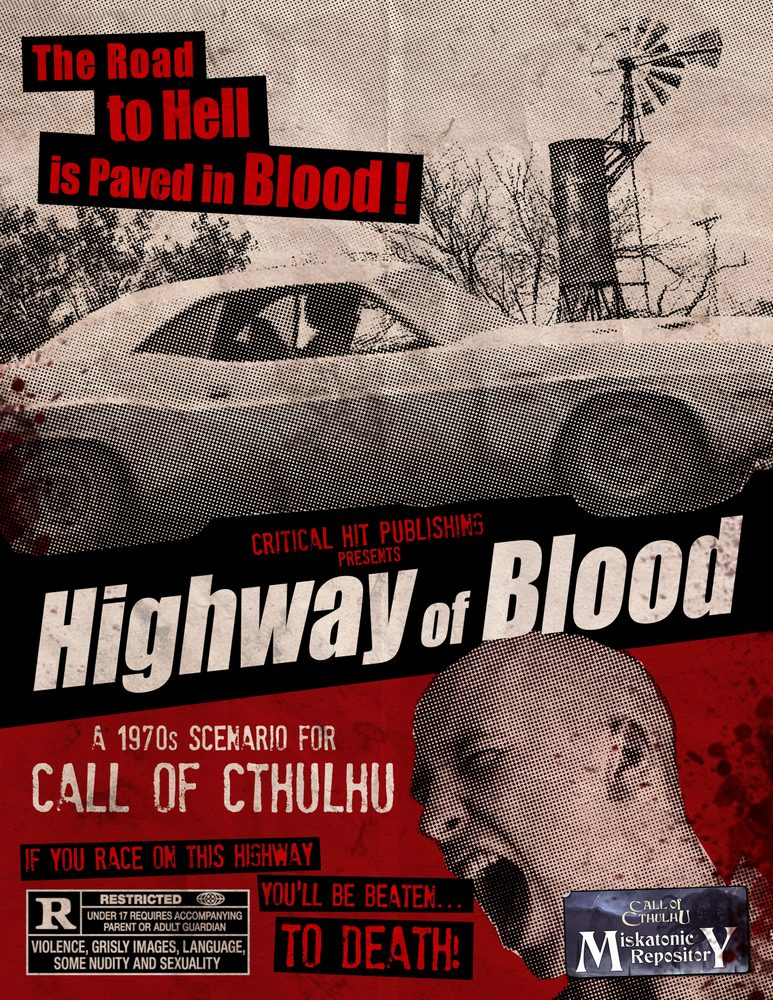

Critical Hit Publishing представляет

ШОССЕ КРОВИ

Сценарий для «Зова Ктулху» в 1970-х

*На обложке — стилизация под киноафишу 1970-х: полузанесённая песком легковая машина, ветряная мельница и голые деревья, внизу — кричащий лысый человек на красном фоне.*

*Надписи на обложке:* **«Дорога в ад вымощена кровью!»** — **«Шоссе крови»** — **«Сценарий для „Зова Ктулху“ в 1970-х»** — **«Если будешь гонять по этому шоссе — тебя забьют… насмерть!»**

*Плашка рейтинга в стиле MPAA: «R — ограничено. До 17 лет — только с родителем или взрослым опекуном. Насилие, жуткие сцены, брань, обнажённая натура и сексуальные сцены». Внизу справа — логотип «Call of Cthulhu — Miskatonic Repository».*
