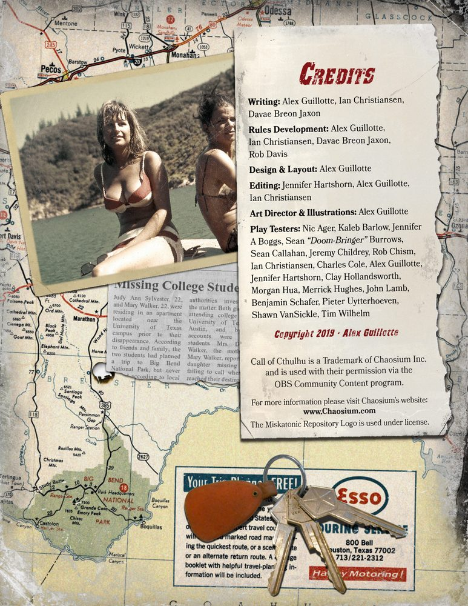

*Фон страницы — коллаж: дорожная карта Западного Техаса (Одесса, Пекос, Марафон, национальный парк Биг-Бенд), фотография двух девушек в купальниках у воды, газетная вырезка «Пропали студентки колледжа» (видно начало: «Джуди Энн Сильвестер, 22 года, и Мэри Уокер, 22 года, снимавшие квартиру недалеко от кампуса Техасского университета… По словам друзей и родных, студентки собирались съездить в национальный парк Биг-Бенд, но так и не…»), рекламный буклет заправок «Эссо» («Ваш план поездки — бесплатно!», «Счастливого пути!») и связка ключей с кожаным брелоком.*

# Выходные данные

**Текст:** Alex Guillotte, Ian Christiansen, Davae Breon Jaxon

**Разработка правил:** Alex Guillotte, Ian Christiansen, Davae Breon Jaxon, Rob Davis

**Дизайн и вёрстка:** Alex Guillotte

**Редактура:** Jennifer Hartshorn, Alex Guillotte, Ian Christiansen

**Арт-директор и иллюстрации:** Alex Guillotte

**Тестеры:** Nic Ager, Kaleb Barlow, Jennifer A Boggs, Sean “Doom-Bringer” Burrows, Sean Callahan, Jeremy Childrey, Rob Chism, Ian Christiansen, Charles Cole, Alex Guillotte, Jennifer Hartshorn, Clay Hollandsworth, Morgan Hua, Merrick Hughes, John Lamb, Benjamin Schafer, Pieter Uytterhoeven, Shawn VanSickle, Tim Wilhelm

*© 2019 Alex Guillotte*

«Call of Cthulhu» — торговая марка Chaosium Inc., используется с её разрешения по программе OBS Community Content. Подробнее — на сайте Chaosium: www.Chaosium.com. Логотип Miskatonic Repository используется по лицензии.
