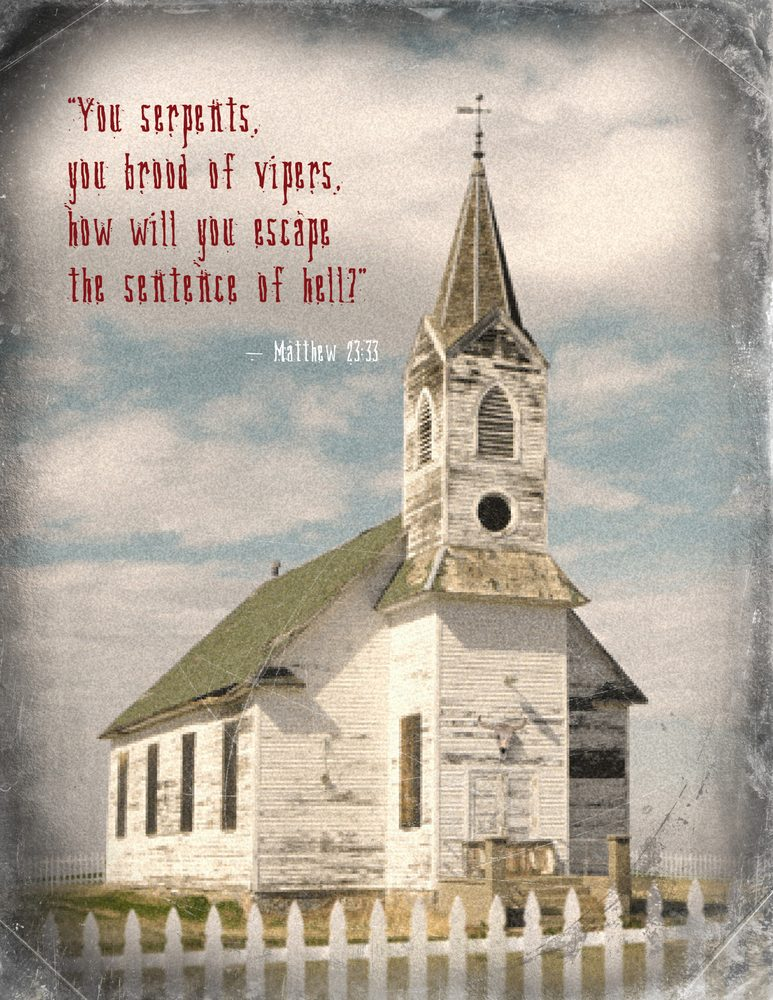

> «Змии, порождения ехиднины! как убежите от осуждения в геенну?»
>
> — Матфей 23:33

*На странице — старая обшарпанная белая деревянная церковь с остроконечной колокольней за белым штакетником; цитата из Евангелия от Матфея в английском оригинале (King James): “You serpents, you brood of vipers, how will you escape the sentence of hell?”; по-русски — в Синодальном переводе.*
