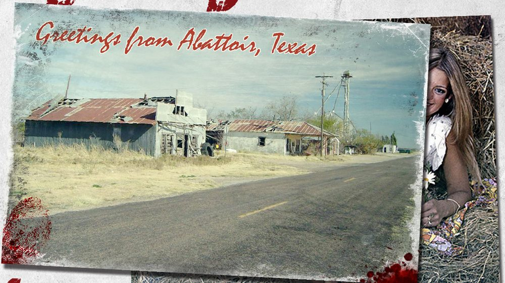

Шоссе крови

*Открытка с надписью «Привет из Абаттуара, Техас»: заброшенные дома с ржавыми крышами вдоль пустой дороги; за ней — фотография светловолосой девушки, лежащей в сене.*

# Сценарий

Действие сценария происходит в Западном Техасе в бурные 1970-е; он задуман как дань уважения классическим «грайндхаусным» и эксплуатационным фильмам того времени. Кроме того, он исследует опасности одиночества, обезвоживания и сильной жары, которыми грозит суровая пустыня.

Сценарий рассчитан на самых разных персонажей игроков (ПИ) — от компании незадачливых подростков до опытных исследователей Мифов. Прежде всего это сценарий на выживание, где главная цель персонажей — просто унести ноги. Разумеется, сказать это легче, чем сделать.

## Обзор

В начале сценария персонажи едут по пустынному участку шоссе в Западном Техасе. За окнами тянутся бесконечные просторы пыли и ведьминой травы, лишь изредка их прерывает телеграфный столб, брошенная лачуга или выцветший дорожный знак. Это такое место, где крохотные островки цивилизации разделены многими километрами беспощадной пустыни, насколько хватает глаз.

Поверив указателю, который обещает последнюю заправку на ближайшие 80 км, они въезжают в городок Абаттуар, штат Техас. Это почти город-призрак, но персонажам удаётся найти бензин и бар, где можно передохнуть, размять ноги и, может быть, перекусить. Они и не подозревают, что их взяла на заметку банда вырожденцев-«дастбилли», которые собираются принести их в жертву тёмному древнему богу. За всем этим стоят безумный проповедник, змеиная жрица Йига и её служители-людоеды, называемые тейхиихан.

Дастбилли преследуют персонажей за городом, и начинается отчаянная автомобильная погоня. Удастся персонажам уйти или нет, скоро становится ясно: покинуть эти края в ближайшее время им не суждено. Дастбилли будут охотиться на персонажей и дальше, потому что у них на них планы: принести в человеческую жертву, сожрать их плоть, обратить в рабов и даже запереть как «племенной скот».

Поскольку это сценарий-песочница, развиваться он может во многих направлениях. Персонажи могут сбежать от дастбилли и укрыться в пустыне — только для того, чтобы на них начали охотиться хищные тейхиихан. Они могут тайком вернуться в город за помощью или спуститься в древние пещеры змеелюдей, чтобы спасти невинных жертв, которых там держат. Если они захотят копнуть ещё глубже, то могут раскрыть истоки этого жуткого культа и решить покончить с ним раз и навсегда.
