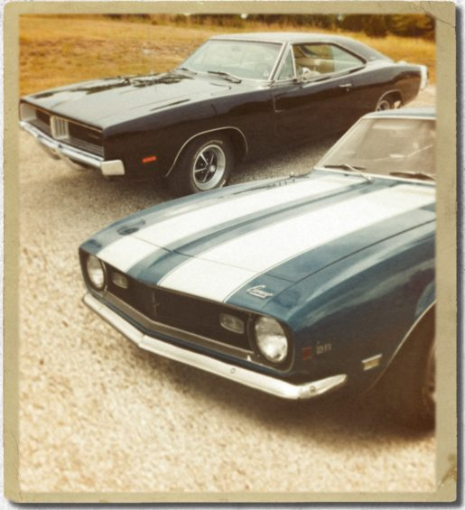

***Исследователи Мифов.*** Группа опытных сыщиков недавно наткнулась на старый документ, из которого следует, что когда-то в окрестностях Хребта Дьявола обитали змеелюди. Хотя признаков недавней активности нет, сыщики хотят разобраться в этом подробнее. Их интерес может быть чисто научным, а может быть частью большой кампании о змеелюдях и культе Йига.

***Тусующиеся подростки.*** 1970-е — время секса, наркотиков и рок-н-ролла. Персонажи — молодёжь (от старших подростков до двадцати с небольшим), которая едет в пустыню оторваться, не оглядываясь на «систему».

***Телерепортёры.*** Местный телеканал готовит серию репортажей о последствиях добычи урана в Западном Техасе. Персонажей послали снять видео в этих краях и расспросить местных о том, что они думают о шахтах и что с ними связано.

## Подготовка

Какой бы тип персонажей ни выбрали игроки, хотя бы у одного из них должна быть машина и навык Вождения автомобиля не ниже 55. Чтобы не испортить сюжет, Хранитель может просто сказать, что дороги, по которым им предстоит ехать, порой коварны.

Ещё игрокам нужно выбрать себе машину. Это стоит подать как деталь антуража, но Хранитель может предложить классический маслкар или, скажем, фургон. Например: *Dodge Challenger 1969 года*, *Chevy Camaro Z28 1968 года*, *Pontiac GTO 1964 года* или *фургон Chevy Conversion Van 1971 года*.

## Мотивы

***Жрица.*** Всё, что происходит на Хребте Дьявола и вокруг него, восходит к змеечеловеку по имени Аль’исса Сс’рисси А’на [*аль-ИСС-я сс-РИСС-и а-НА*]. Она повелевает тейхиихан и дастбилли, а те, в свою очередь, держат в руках жителей Абаттуара. Великих замыслов у Аль’иссы пока нет — лишь восстановить храм Йига и вырастить своё войско тейхиихан. Разумеется, как и все змеелюди, она презирает млекопитающих и, за исключением собственных полезных слуг, с радостью стёрла бы их всех с лица Земли.

***Книга.*** Аль’исса Сс’рисси А’на одержима желанием найти и вернуть *De Vermis Mysteriis* (см. приложение V на с. 97), чтобы, когда её сила станет достаточной, призвать Йига и властвовать над этими жалкими созданиями. Если она заподозрит, что книга у определённого человека, она спустит за ней нескольких обитателей песков. Тейхиихан она поначалу не пошлёт — из-за их крайней жестокости: ей нужно, чтобы книгу вернули в целости.

Учтите: если у кого-то оказалась книга или он хотя бы прикоснулся к ней и при этом находится не в защищённом месте (***сувениры «Громовая птица»*** или ***пятидесятническая церковь «Кровь Агнца»***), Аль’исса узнаёт о нём и примерно представляет, где он находится (например, в ***городке Абаттуар***, рядом с ***шахтами «Уэйленд»***, на дороге к югу от ***Усадьбы*** и т. п.). Отнять у него книгу становится для неё задачей номер один.

***Охота.*** Дастбилли всегда высматривают возможных жертв для *Охоты* — ритуальной автомобильной погони, которая готовит жертв к жертвоприношению. Дастбилли не слишком умны, но занимаются этим достаточно давно, чтобы легко замечать подходящую добычу. Заметив её, они поручают своим союзникам в городе собрать сведения о будущих жертвах и подталкивают горожан отправить их из города на восток по Ред-роуд (она же *Шоссе крови*). Для этого дастбилли заранее выводят из строя мост через овраг к западу от города.

Дастбилли и правда наслаждаются *Охотой*, но за ней стоит более глубокий, ритуальный смысл. Чтобы стать достойными жертвоприношения, жертвы должны быть затравлены, и им должна быть дана возможность — пусть ничтожная — уйти от преследователей. Разумеется, до сих пор это не удавалось никому.

Когда погоня началась, дастбилли обязаны соблюдать два правила. Первое: жертв по возможности нужно брать живыми — чтобы, в зависимости от пола и возраста, использовать их для ритуального жертвоприношения, в пищу или для размножения. Второе: никто не должен уйти. Если выбора нет, второе правило важнее первого, хотя преподобный Остин (см. «Предысторию» на с. 9)
