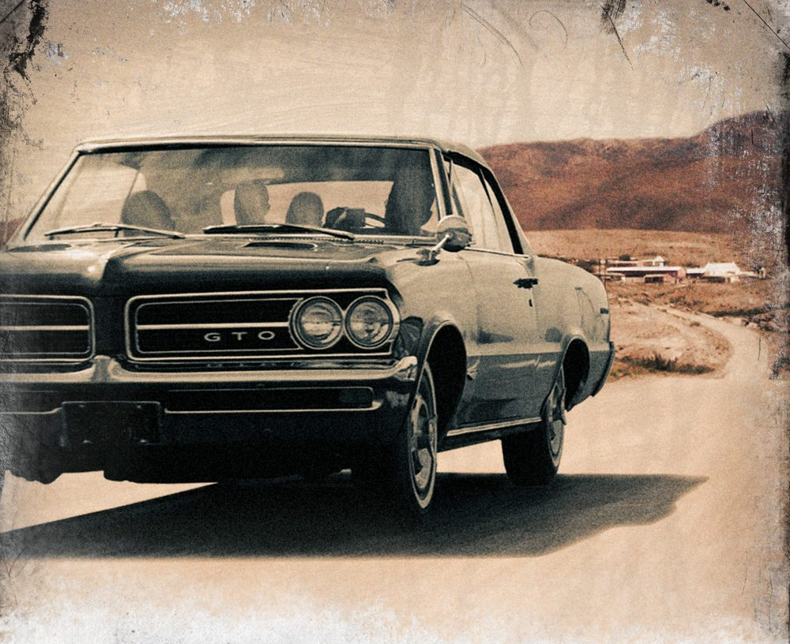

# Как вести сценарий

Основная посылка сценария — персонажи угодили в ловушку, поэтому у него нет заданного сюжета или апокалиптического срока. Лучше всего Хранителю вести его, понимая планы и мотивы всех участников: жителей Абаттуара, дастбилли, тейхиихан и, в конечном счёте, самой змеиной жрицы Аль’иссы Сс’рисси А’на.

Готовясь к сценарию, Хранителю стоит познакомиться с историей, массовой культурой, музыкой и разговорным языком середины 1970-х, особенно в Западном Техасе.

В начале сценария Хранителю следует словами нарисовать яркую картину места и обстановки, чтобы задать настроение. Вступительное описание приведено, но Хранитель волен приукрасить его, как сочтёт нужным.

Когда персонажи окажутся в Абаттуаре, им нужно дать свободу передвигаться как угодно. На этом этапе важно постепенно нагнетать паранойю, описывая, как местные наблюдают за ними, перешёптываются у них за спиной и так далее.

Помимо очевидных угроз, большую роль в этом сценарии играет окружающая среда. На Хребте Дьявола и в его окрестностях стоит изнуряющая жара, и Хранителю стоит подчёркивать это при любой возможности: описывать гнетущий зной, непрекращающийся пот и неутолимую жажду. В начале этой книги есть правила о жаре и обезвоживании, а также опасности пустыни, которыми Хранитель может подогревать напряжение, когда сочтёт нужным.
