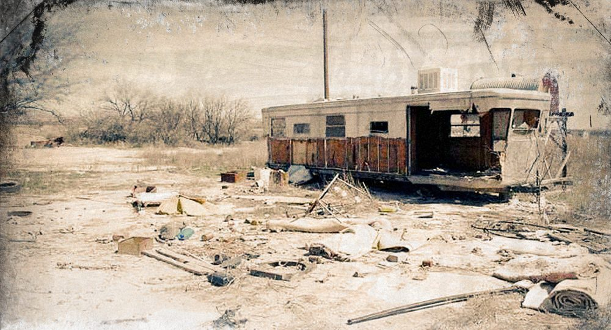

# Абаттуар

## Жители

Отыгрывая жителей Абаттуара, Хранителю следует помнить, что не все настроены против ПИ, а кто-то при должном убеждении может даже помочь. Важно следить, что знает конкретный человек и замешан ли он в заговоре дастбилли. Если замешан, нужно учитывать и то, почему он в этом участвует.

Разумеется, у каждого НИП свой характер, но следующий список даёт Хранителю несколько ориентиров, на которых можно строить.

***Напуганный (Af).*** Как правило, эти люди многое знают о происходящем, но они в ужасе и не хотят неприятностей. Поскольку угрозы для дастбилли они не представляют, их обычно не трогают. Такие жители стараются держаться от персонажей подальше, чтобы не брать на себя ответственности или вины за их судьбу.

***Равнодушный (Ap).*** Эти жители, может быть, и догадываются, что что-то происходит, но думают только о себе и не хотят ни во что ввязываться. Они ведут себя так, будто ничего не замечают, но могут выдать свою осведомлённость, и персонажи могут это уловить. Если их попросить о помощи, они откажут. Они не обязательно выдадут дастбилли, где находятся ПИ, — разве что сами окажутся под угрозой. Но чаще всего они будут просто сволочами.

***Соучастник поневоле (Cf).*** Эти люди знают многое из происходящего и участвуют в нём из страха за себя, своих близких или за тех и других. Не исключено даже, что дастбилли их шантажируют, зная о них что-то, что им не хочется предавать огласке. Такой запуганный соучастник сделает порученное — будь то передать персонажам ложные сведения, испортить их машину или просто собрать сведения о приезжих.

Стоит отметить, что это не обязательно плохие люди. Персонажи, возможно, сумеют уговорить их помочь, но лишь если смогут достаточно убедительно заверить, что им или их близким ничего не грозит. Однако в большинстве случаев страх возьмёт верх, поэтому особого доверия они не заслуживают. В конечном счёте Хранителю решать, смогут ли персонажи убедить их отыгрышем и успешными проверками социальных навыков.

***Соучастник по своей воле (Cw).*** Одни участвуют, потому что у них почти нет выбора, но немало жителей с удовольствием делают то, о чём их просят. Потому ли, что им хорошо платят, или потому, что они психопаты, или по обеим причинам, — они без колебаний обманывают персонажей и отправляют их на бойню. Разумеется, они многое знают о происходящем, хотя во внутренний круг не входят и потому мало знают об Усадьбе, Остине, тейхиихан и других силах, действующих за кулисами.

Добиться помощи от этих людей трудно, если вообще возможно. Единственное исключение — если персонажи предложат
