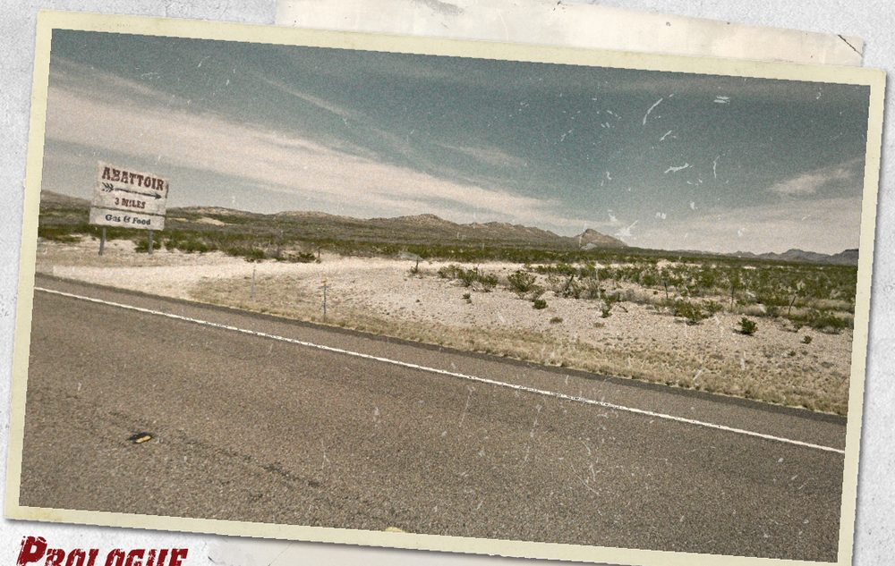

# Пролог

## Западный Техас, июль 1975 года

> *Бесконечная лента асфальта тянется к точке схода у низких холмов на горизонте, хотя из-за марева расстояние почти не угадать. Машина превратилась в духовку: температура перевалила за 38 °C, а ещё нет и одиннадцати утра. Вы разделись до того минимума одежды, который требуют приличия, но всё равно выглядите так, будто только что вылезли из бассейна. Открытые окна почти не помогают — горячий ветер больше похож на промышленный фен. Воды вам хватает, чтобы не страдать от жажды, но она такая тёплая, что пьёшь словно жидкий чай.*
>
> *Вам говорили, что до следующего города по шоссе недалеко, но за последние 30 км вы не видели даже знака ограничения скорости. Стрелка бензина только что опустилась ниже половины бака, и хотя никто ничего не говорит, всем становится немного не по себе. Вы даже не уверены, что поворот назад сейчас что-нибудь изменит.*
>
> *И тут вы видите его. Солнце бликует на выцветшей металлической вывеске: слишком уж весёлый заправщик в дурацкой ковбойской шляпе — похоже, ещё из 1950-х. Над его головой мультяшный пузырь с надписью:* **«ПОЧТИ ПРИЕХАЛ, ПАРТНЁР!»** *Под ним — облезлая эмблема* **Esso***. И будто спохватившись, к столбу под ней прибита маленькая табличка:* **«8 км и направо»***.*
>
> *Как и обещано, через 8 км вы видите уходящую вправо грунтовую, но хорошо наезженную дорогу. На слегка покосившемся деревянном столбе прибиты две таблички. Верхняя гласит:* **«Абаттуар 5 км»***. Нижняя — просто:* **«Бензин и еда»***.*

Где-то до поворота персонажи слышат по радио Койота Майка: его низкий баритон льётся из динамиков, как патока. Он говорит:

> *«Добро пожаловать в очередной денёк в седьмом круге ада: ртуть у нас тут, на Хребте Дьявола, обещает перевалить за 43 градуса, и завтра лучше не будет. Как говаривал мой старый дед: направление ветра не изменишь, но паруса всегда можно поставить так, чтобы дойти куда надо. Не знаю, куда вы держите путь, друзья мои, но вот вам кое-что, чтобы катилось по шоссе веселей!»*

В этот момент по радио начинает звучать песня *Roll On Down the Highway* группы Bachman-Turner Overdrive (см. плейлист в ***«Хронологии событий»*** на с. 70).
