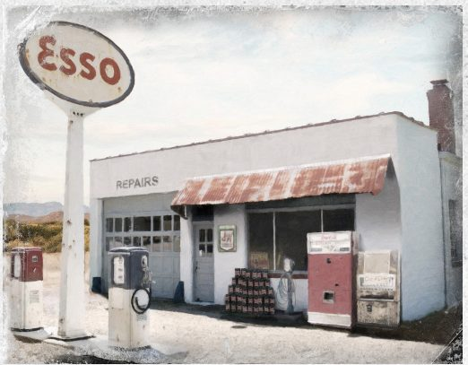

# Добро пожаловать в Абаттуар

> *Пыльная дорога ведёт вас через гряду холмов, крутыми поворотами, которые словно возникают из ниоткуда, и через старинный деревянный мост, пока наконец вы не въезжаете в городок Абаттуар. Самодельная вывеска гласит:* **«Добро пожаловать в Абаттуар»***, а ниже:* **«Население 850»***. Вывеска явно старая, и её давно не исправляли под нынешнее положение дел.*
>
> *Абаттуар — почти город-призрак: много заброшенных домов, пустых ям от погребов и брошенных машин, которые стоят тут, похоже, не одно десятилетие. Через город идёт одна главная улица, а от неё под странными углами расходятся несколько второстепенных. В том, что, должно быть, считается центром города, стоят* ***заправка «Эссо»***, ***универсальный магазин Мэзерса*** *и* ***бар и мотель «Последняя остановка»***. *В конце одной из боковых улиц виднеется шпиль — видимо, какой-то церкви. Перед заправкой сидят несколько мужчин. Они провожают вас взглядом, пока вы въезжаете в город.*

# Абаттуар, Техас

## 1. Заправка «Эссо»

***Описание.*** *Вывеска над заправкой старая и выцветшая, но название ещё можно прочесть. В грязном окне стоит картонная табличка* **«ОТКРЫТО»***. Две бензоколонки довольно допотопные, но, похоже, работают. Ворота единственного ремонтного бокса открыты, на подъёмнике стоит Chevy Nova 1974 года, хотя сейчас над ней, кажется, никто не работает. Вдоль передней стены выстроились банки с маслом; судя по тёмным пятнам на земле, одна или несколько из них протекли.*

*Перед заправкой в тени низкого навеса из гофрированного железа сидят трое мужчин. Их кожа сильно загорелая и морщинистая, отчего они кажутся очень старыми, но, приглядевшись, понимаешь, что им, скорее всего, лет по сорок-пятьдесят. Слева от них — ржавый автомат* **«Кока-Кола»***, который пронзительно гудит, и сигаретный автомат с большой надписью от руки:* **«Не работает»***.*

***Примечательные предметы.*** Для захолустной заправки посреди глуши ремонтный бокс оборудован неплохо. Здесь есть полный набор автомеханических инструментов, газовый резак, профессиональный воздушный компрессор и подъёмник. В конторе на стене висит старый дробовик. Он заряжен каменной солью — против койотов, — но за ним давно не ухаживали. Без хорошей чистки (около часа с нужными инструментами) он даёт осечку при любом результате броска выше 80.

***НИП.*** Днём здесь обычно можно застать троих: Расса Уильямса, Нейта Паттерсона и Стива Брауна. Чаще всего они сидят перед заправкой, курят и пьют пиво в тени её широкого навеса.

<u>Расселл Уильямс</u> — Расс (местные иногда зовут его «Руссо») — владелец заправки. Возраст его трудно определить, потому что он явно много времени провёл под открытым небом, но седеющие волосы говорят, что ему как минимум сорок пять. Расс — высокий, долговязый мужчина в белой рубашке на пуговицах и на удивление чистом комбинезоне. Из заднего кармана свисает промасленная тряпка, а в закатанный рукав завёрнута пачка сигарет. Расс туговат на соображение и старается не лезть в чужие дела. Человек он не слишком набожный, но каждую неделю ходит на службы преподобного Скотта.

> **Заметки Хранителя**
>
> Расс до ужаса боится дастбилли, но, поскольку он нужен им для заправки и ремонта машин, его и его сына Рэндалла обычно не трогают. Расс не станет рисковать налаженной жизнью ради персонажей без долгих уговоров, и в уговоры должен входить способ для него и сына навсегда уехать из этих мест. При этом он постарается ненавязчиво выпроводить персонажей из города как можно скорее. Например, если персонажи спросят о еде в «Последней остановке», Расс может сказать: *«Ой, не надо вам там есть. Чувак, последний раз как я пожрал в этой дыре, блевал неделю, как больная псина, мать её».*

<u>Нейт Паттерсон</u> — Нейт, водитель грузовика на пенсии: среднего роста, с залысинами, брюшком и плохими зубами. Одежда у него нечистая, но пахнет он не так плохо, как мог бы. Живёт он на пособие по социальному обеспечению на Ридж-роуд, по соседству со Стивом Брауном. Много времени проводит на заправке, где делает вид, что помогает Рассу чинить машины, а на деле обычно стоит в сторонке и держит сигарету Расса, пока тот лезет под машину. Нейт добродушный и слишком много болтает о своей жизни в дороге.
