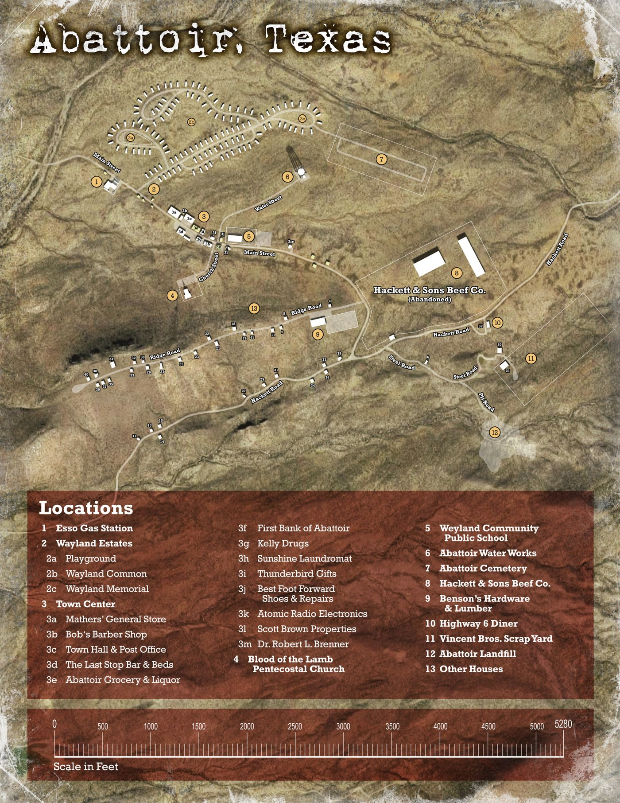

## Карта Абаттуара

*Спутниковый снимок окрестностей городка с нанесёнными номерами мест, улицами (Main Street — Мейн-стрит, Water Street — Уотер-стрит, Church Street — Чёрч-стрит, Ridge Road — Ридж-роуд, Hackett Road — Хэкетт-роуд, Steel Road — Стил-роуд, Red Road — Ред-роуд, Pit Road — Пит-роуд) и номерами домов; в центре — заброшенный мясокомбинат «Хэкетт и сыновья» (Hackett & Sons Beef Co., «Abandoned»).*

**Места**

| № | Место |
|---|---|
| 1 | Заправка «Эссо» |
| 2 | «Уэйленд-Эстейтс» |
| 2a | Детская площадка |
| 2b | Общий двор |
| 2c | Мемориал «Уэйленд» |
| 3 | Центр городка |
| 3a | Универсальный магазин Мэзерса |
| 3b | Парикмахерская Боба |
| 3c | Ратуша и почта |
| 3d | Бар и мотель «Последняя остановка» |
| 3e | Бакалея и винный магазин Абаттуара |
| 3f | Первый банк Абаттуара |
| 3g | Аптека Келли |
| 3h | Прачечная «Саншайн» |
| 3i | Сувениры «Громовая птица» |
| 3j | Обувь и ремонт «Твёрдый шаг» |
| 3k | Радиоэлектроника «Атомик» |
| 3l | «Скотт Браун пропертиз» |
| 3m | Доктор Роберт Л. Бреннер |
| 4 | Пятидесятническая церковь «Кровь Агнца» |
| 5 | Общественная школа «Уэйленд» |
| 6 | Водопровод Абаттуара |
| 7 | Кладбище Абаттуара |
| 8 | Мясокомбинат «Хэкетт и сыновья» |
| 9 | Скобяные товары и лесоматериалы Бенсона |
| 10 | Закусочная «Шоссе 6» |
| 11 | Свалка братьев Винсент |
| 12 | Свалка мусора Абаттуара |
| 13 | Прочие дома |

*Шкала: масштаб в футах, от 0 до 5280 футов (1 миля ≈ 1,6 км; деление 500 футов ≈ 150 м).*

*Прим. перев.: так в оригинале — в ключе карты «Bob’s Barber Shop», а в тексте (с. 25) — «Парикмахерская Тома» (Tom’s Barber Shop). На карте посёлок подписан «Wayland Estates», в тексте — «Weyland Estates».*
