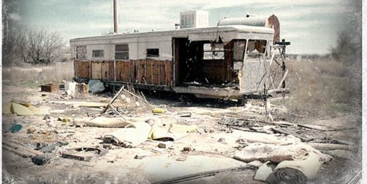

> **Заметки Хранителя**
>
> К дастбилли Нейт относится безразлично: считает, что в них «кровь играет», как играла у него самого, когда он рос в Кентукки. Что они творят, он не замечает, а по вечерам сильно пьёт у себя в трейлере и часто отключается ещё до одиннадцати.

<u>Стив Браун</u> — на вид Стиву под семьдесят, но для своих лет он довольно бодр. У него коротко стриженные седые волосы, кривой нос и обветренная кожа. Руки покрыты флотскими татуировками. Стив молчалив и сдержан, но, если ему есть что сказать, говорит твёрдо и убеждённо.

> **Заметки Хранителя**
>
> Прослужив несколько десятилетий на флоте, Стив искал спокойной жизни на пенсии в родном Техасе. Двенадцать лет назад умерла его жена, и теперь он живёт один на Ридж-роуд со своей древней собакой. Он изо всех сил старается не замечать, что творится вокруг, и весьма успешно убедил себя, что это самый обычный провинциальный городок. Если ПИ придут к нему в отчаянной нужде, в крайнем случае он может помочь, но убедить его, что дело в чём-то большем, чем обычное буйство дастбилли, будет трудно. Без убедительных доказательств, чтобы он всерьёз выслушал, любые проверки на это требуют *трудного* успеха.

## 2. «Уэйленд-Эстейтс»

***Описание въезда.*** *Вывеска у въезда в* ***«Уэйленд-Эстейтс»*** *явно из 1950-х. На ней — мужчина в синем деловом костюме, по бокам от него заботливая жена в фартуке и очаровательные дети, прильнувшие к его ногам. Это неправдоподобное семейство в маниакальном восторге взирает на идеализированное изображение трейлеров посёлка. Дав волю фантазии, художник поместил закат за трейлерами — на севере. Буквы* **«Уэйленд-Эстейтс»** *когда-то были выкрашены металлическим золотом, но большая часть краски облезла, обнажив выбеленное дерево.*

*Солнце и вандалы не пощадили вывеску. Когда-то яркие краски выцвели, а поверхность изрешечена пулями: у каждого члена семьи на голове и груди красуется весьма внушительная кучность попаданий.*

***Общее описание.*** *Дорогой, ведущей в посёлок, похоже, ездят редко. Дворы заросли, а трейлеры, похоже, брошены довольно давно. Все они немного отличаются друг от друга, но время и непогода стёрли почти все те личные мелочи, благодаря которым когда-то это место было для кого-то домом. Одни ещё сохраняют очертания, другие частично обрушились. Эти последние полны грязи и пыли, нанесённых за годы ветром, а в некоторых даже растёт ведьмина трава.*

Большинство этих передвижных домов (см. раздатку 5) построены примерно в одно время, в основном на деньги *горнодобывающей компании «Уэйленд»*, чтобы поселить её рабочих. Поэтому все они почти одинаковы по устройству и планировке: прямоугольные (примерно 16×4 м), белые, с алюминиевым навесом вдоль той стены, где дверь. Немногие стоят на фундаменте из шлакоблоков, но большинство — просто на колёсах, с четырьмя регулируемыми стальными опорами по углам. Во многих выбиты стёкла, и потрёпанные, выгоревшие на солнце занавески треплются на ветру пустыни.

Вокруг трейлеров можно найти крошащиеся кирпичные патио, ржавые грили для барбекю, брошенные баллоны с пропаном, металлические мусорные баки, полные пустых пивных бутылок, а иногда и остатки машины многолетней давности.

***Примечательные предметы.*** Обыскивая бесчисленные трейлеры, можно найти вещи или улики, потенциально полезные персонажам. Если персонажи начнут рыться в каком-нибудь трейлере (или прятаться в нём, спасая свою жизнь), Хранителю следует попросить их пройти проверку Удачи. Успех означает, что там есть что найти, и тогда персонажи проходят проверку Внимания. Успех — один бросок по таблице, *трудный* успех — два броска, *чрезвычайный* успех — один бросок и один выбор Хранителя из таблицы. Выбор Хранителя должен быть либо чем-то очень полезным в нынешнем положении персонажей, либо значимой уликой. Во втором случае Хранитель волен импровизировать как нужно — в зависимости от того, требуется ли персонажам более сильный толчок в правильном направлении.

| Бросок | Находка |
|---|---|
| 01 | Погнутая ржавая монтировка (можно использовать как дубинку). |
| 02 | Полупустая бутылка дешёвого рома, который ещё можно пить. |
| 03 | Агрессивная гремучая змея бросается на первого вошедшего. Персонаж должен пройти проверку Удачи, иначе получает дозу яда (см. «Книгу хранителя», с. 129). |
| 04 | Канистра бензина на 4 л. |
| 05 | Чугунная сковорода, которую плохо отмыли после последнего использования больше двадцати лет назад. |
