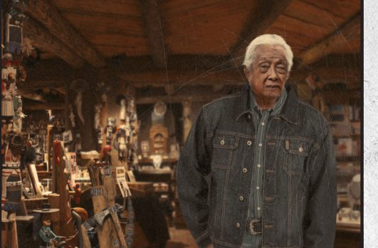

***Примечательные предметы.*** Здесь удобно запастись простыми медицинскими средствами. Если кто-то явно ранен, Гарри (хозяин аптеки) сделает что может, чтобы помочь. Со времён Корейской войны у него есть подготовка по расширенной первой помощи, и он может предложить помощь и при более серьёзных ранениях, если сумеет.

***НИП.*** <u>Гарольд «Гарри» Келли</u> — Гарри — крепкий на вид мужчина лет пятидесяти пяти. Среднего роста, плотного сложения, с седеющими волосами и бледно-голубыми глазами. Он приветлив и услужлив и говорит с сильным южным протяжным выговором.

> **Заметки Хранителя**
>
> Гарри — хозяин аптеки, он сам ведёт дела; ветеран Корейской войны с наградами. Они с женой Хелен открыли аптеку в 1954 году, после его возвращения из Кореи, но вскоре после переезда в Абаттуар жена умерла.
>
> Гарри терпеть не может дастбилли, хотя не знает всех масштабов их деятельности. Он видит в них в основном «хулиганьё», от которого одни неприятности, но дальше слов «Кто-то должен что-то сделать» в разговорах с таким же недовольным местным не пошёл.
>
> Тем не менее, если персонажи придут к нему за помощью, он без колебаний сделает что сможет. У него военная подготовка и подготовка по первой помощи, а за прилавком он держит двуствольный дробовик. В квартире над аптекой у него хранится и старый револьвер .45 калибра, который он носил на войне.
>
> В конечном счёте он верит, что поступать нужно правильно, и он не трус. Если дойдёт до дела, он даже готов отдать жизнь, защищая других. Он знает, что Хелен хотела бы этого.

### 3h. Прачечная «Саншайн»

***Внешний вид.*** *Одно из самых новых зданий в городе, построено где-то в начале 1960-х. Две стены почти целиком стеклянные, на обеих — эмблема* *«Саншайн»* *(жёлтое мультяшное солнце, буквы окрашены градиентом заката). Вывеска хвалится часами работы:* *с 6 утра до 9 вечера, без выходных**.*

***Внутри.*** *Вдоль задней стены — пять стиральных машин и пять сушилок, разменный автомат и сигаретный автомат. Под передним окном выстроились в ряд двенадцать ярко-оранжевых пластиковых стульев, через каждые три стула — напольная пепельница. Справа — застеклённая контора с маленьким столом, стулом и кладовкой для уборочного инвентаря.*

***Примечательные предметы.*** Кроме чистящих средств, ничего особенно полезного здесь нет.

***НИП.*** <u>Брайан Уэстбрук</u> — Брайан — темноволосый мужчина средних лет, немного полноватый, но в остальном здоровый. Он молчалив, но не неприветлив, хотя ввязываться ни во что, похоже, не хочет.

> **Заметки Хранителя**
>
> Брайан купил прачечную «Саншайн» пять лет назад: после безвременной смерти жены от рака ему хотелось уехать из города. О дастбилли он знает мало — только их поверхностную славу смутьянов — и предпочитает не высовываться. Если дойдёт до дела, он не даст человеку умереть, но сначала изо всех сил постарается найти отговорки, чтобы не ввязываться.
>
> Раз в неделю он опорожняет кассы стиральных машин и сушилок, относит деньги в банк и заходит в универсальный магазин за своим недельным заказом продуктов.

### 3i. Сувениры «Громовая птица»

***Внешний вид.*** *Это простое деревянное строение похоже на старую лавку Дикого Запада — с фальшфасадом, деревянным крыльцом и коновязью. Над дверью — искусно расписанная вывеска: группа индейцев смотрит вдаль с торжественным, почти печальным выражением. За ними — огромная стилизованная птица на фоне тёмных грозовых туч. Название лавки —* *«Громовая птица»* *— выведено крупными старомодными буквами.*

*Окно в двери обклеено листовками, многим из которых не один год, и объявлением о «распродаже в связи с закрытием», которому по меньшей мере десять лет.*

> **Заметки Хранителя**
>
> Любой, кто хоть немного знаком с местными индейскими культурами, поймёт, что люди на вывеске — вполне достоверное изображение апачей.

***Внутри.*** *Запах шалфея силён ещё до того, как откроешь дверь этого простецкого заведения. Когда дверь открывается, наружу выплывает облачко дыма, и персонажей встречает картина организованного хаоса. Середину лавки занимают несколько заставленных витрин с трубками, кисетами, безделушками и разными украшениями из серебра, бирюзы и бисера. Вдоль стен — вешалки с одеждой из оленьей кожи.*
