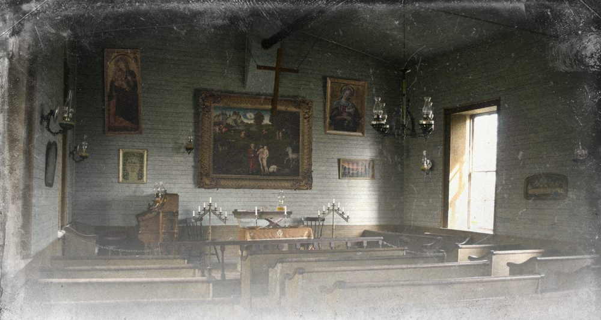

## 4. Пятидесятническая церковь «Кровь Агнца»

***Описание.*** *На невысоком пригорке у центра города стоит выцветшая деревянная сельская церковь. Единственный узкий шпиль тянется в безоблачное небо, металлическая крыша покрыта налётом ржавчины. Ставни звонницы закрыты, и кажется, что их не открывали лет пятьдесят.*

*Входные двери когда-то были выкрашены в синий цвет, но почти вся краска давно облупилась, обнажив серую, выветренную сосну. По каждой стороне церкви тянется ряд из четырёх высоких окон; на их витражах неведомых мучеников казнят разными жуткими способами. Ступени крыльца разваливаются, но, если быть осторожным, по ним ещё можно подняться.*

*Церковь окружена штакетником высотой около метра; судя по его состоянию, он поставлен одновременно с церковью — надо полагать, в начале 1800-х. Слева от церкви — древнее кладбище с надгробиями из сланца и единственным грубым мавзолеем. Это низкое строение, похоже, сложено из местного камня.*

*Присмотревшись, можно заметить над окнами и входной дверью примитивные обереги из костей и сухожилий (раздатка 23). Есть и другие украшения — из перьев и черепов с синими знаками, нарисованными на лбу каждого. Большинство черепов, похоже, принадлежали мелким млекопитающим (вероятно, койотам), но тот, что над входной дверью, явно бизоний.*

*Деревянная вывеска перед церковью — самое новое, что здесь есть (ей, вероятно, меньше 10 лет); на ней написано* *«Пятидесятническая церковь „Кровь Агнца“»**, а ниже —* *«Основана в 1965 г.»**.*

***Предметы.*** Когда преподобный Скотт не в своей крохотной квартирке, он держит свой двуствольный обрез (который ласково назвал *«Праведной яростью»*) в кафедре, в плохо спрятанном отделении. Любой, кто посмотрит на кафедру со стороны проповедника, легко увидит, как она открывается. Ночью, ковыляя спать, преподобный забирает «Праведную ярость» с собой.

***НИП.*** <u>Преподобный Уильям «Билли» Скотт</u> — преподобный Скотт — пожилой человек, чей возраст трудно определить точно; ему где-то от 60 до 70 лет. Всклокоченные седые волосы окружают его голову, словно нимб, глаза тёмные и слезящиеся. Он носит чёрные брюки, чёрную рубашку с коротким рукавом, пасторский воротничок и ходит босиком. От Билли вечно пахнет виски — даже когда он не пьёт, что бывает нечасто.

> **Заметки Хранителя**
>
> Если кто-нибудь неожиданно подойдёт к церкви или войдёт в неё, преподобный Скотт из-за двери главного входа приставит ему к голове дробовик. Убедившись, что перед ним не дастбилли и не кто похуже, он приглашает гостей войти и предлагает выпить (обычно виски, хотя на заднем дворе у него есть и вода).
>
> К своей вере он относится довольно непринуждённо: пьёт, поднимая тост за алтарь, и разговаривает с «Господом Богом», как со старым другом. Иными словами, не всегда вежливо — порой называет его «этим всемогущим ублюдком».
>
> Билли крепко подружился с Джоном Тандером, хозяином аляповатой сувенирной лавки в городе, и именно Джон предупредил Билли о злых духах. Он же дал Билли защитные фетиши, которые охраняют входы в церковь.
