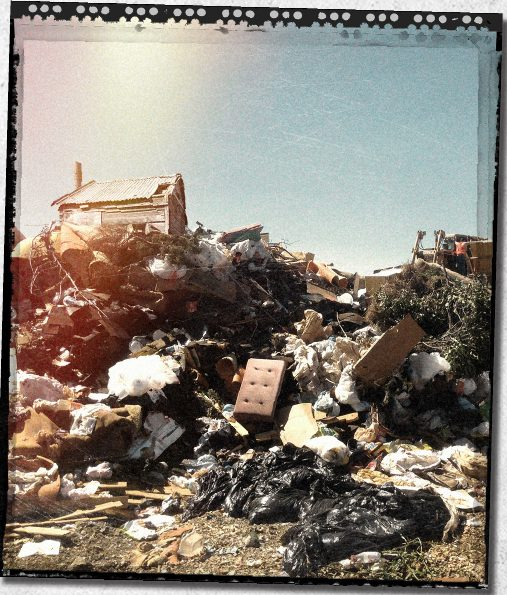

> **Заметки Хранителя**
>
> Братья не дастбилли, но знают, что те охотятся на чужаков и убивают их, и их это не смущает. Они часто без всяких вопросов покупают машины, которые им пригоняют дастбилли, и снимают с них запчасти, нужные, чтобы держать на ходу собственные машины.
>
> Откуда именно берутся машины, братья не знают, и им не настолько интересно, чтобы спрашивать. Если на них надавить, братья, будучи трусами, отправят персонажей разговаривать с Сетом. Если они почуют от персонажей неприятности, то по рации из конторы позвонят Сету и предупредят его.

## 12. Свалка мусора Абаттуара

***Внешний вид.*** *Свалка — огромный холм мусора, медленно сползающий вниз по склону. На ровной площадке наверху, с западной стороны, стоит большой бульдозер, а справа — маленькая лачуга. Окном в лачуге служит проём, завешенный рваной занавеской. Дверь плохо подогнана и, похоже, вытащена из мусора.*

***Внутри (лачуга).*** *Джеральд добровольно никого в свою лачугу не пустит, но если туда всё же войти, внутри окажется трёхногий стул, у которого недостающую ножку заменяет шлакоблок, грязный холодильник-сумка с тёплыми банками газировки и вентилятор, включённый в цепочку удлинителей, протянутых к свалке братьев Винсент.*

*Обернувшись, чтобы осмотреть изнутри переднюю стену лачуги, персонажи видят череду жутких снимков пыток и смерти — в основном женщин. Многие жертвы связаны и избиты, на их лицах — отчаянная безысходность, или же они в кататоническом оцепенении. Многие женщины сняты в обитых мягким материалом комнатах с красноватым светом, где на стенах нарисованы радуги, единороги и плюшевые мишки. На других снимках — тела, обгоревшие дочерна, так что не понять, мужчина это или женщина. Похоже, снимки сделаны фотоаппаратом мгновенной печати «Полароид».*

> **Заметки Хранителя**
>
> Снимки настолько ужасны, что требуется проверка Рассудка (1/1D6). Если персонажи ищут пропавшую девушку или женщину, потеря Рассудка может быть больше (на усмотрение Хранителя).

***Примечательные предметы.*** Если сыщики захотят порыться в мусоре, там могут найтись останки прежних жертв, но для этого нужен *чрезвычайный* успех.

***НИП.*** <u>Джеральд Брюстер</u> — Джеральду под пятьдесят; он заметно тучен, у него короткие чёрные волосы и тёмные глаза, одет в грязный джинсовый комбинезон. Рубашки на нём нет, на ногах — резиновые сапоги до колен, в кармане — револьвер .38 с укороченным стволом. С незнакомцами Джеральд очень груб и орёт на них: *«Валите на хрен отсюда! Нечего вам тут делать!»* — или что-то в этом роде. [*Пункты здоровья: 10; Уклонение: 20; Стрельба (пистолет): 35*]

> **Заметки Хранителя**
>
> Джеральд управляется со свалкой один. Он сторонник дастбилли и охотно избавляется от всего, от чего им нужно избавиться (в основном от тел) так, чтобы не узнал Остин. В награду за молчание Сет приносит ему фотографии их жертв, в том числе из Красного дома. Узнай об этом Остин, он, скорее всего, велел бы сжечь Джеральда на ветряной мельнице, а Сета в наказание подверг бы пыткам.
>
> Если появятся ПИ, Джеральд потребует ответа, какого чёрта им тут надо. Он попытается запугать их, чтобы ушли. Если они не служители закона и кажутся опасными, он наставит на них свой короткоствольный .38 и потребует уйти. Если они будут упираться, он без колебаний выстрелит. Если ПИ — служители закона, Джеральд бросится бежать вниз по мусорному склону, стреляя во всякого, кто попытается его остановить. Если поимка покажется неизбежной, он пустит себе пулю в рот, лишь бы не встретиться с гневом Остина.
>
> В нагрудном кармане у него два ключа: один от бульдозера, другой от его дома (Хэкетт-роуд, 34). Там же лежит его любимый снимок («полароид»): замученная молодая женщина лет двадцати. Она связана, во рту кляп, она сильно избита, а на лице — ужас.

***Чудовища.*** В мусоре прячется стая крыс-мутантов (см. приложение). Обычно они сидят глубоко в норах, но из-за жары многие выбрались на поверхность. Свет они не любят, но проверка Внимания может заметить, как в отбросы юркнул белый хвост длиной сантиметров шестьдесят. Если ПИ придут ночью, крысы нападут, если кто-нибудь станет ворошить мусор.

