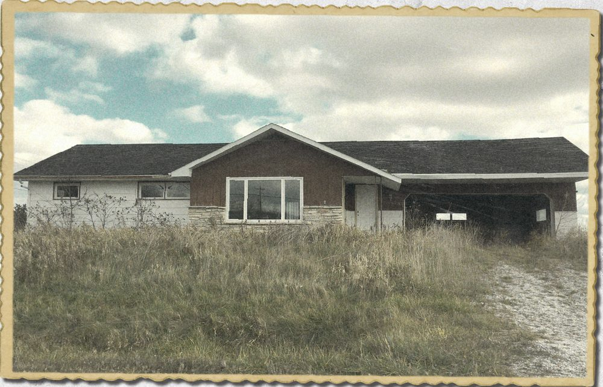

## 13. Жилые дома

***Описание.*** *Большинство домов в Абаттуаре — раскидистые одноэтажные дома-ранчо. У них широкие фасады, гаражи, обращённые к улице, пологие крыши; когда-то их красили в разные цвета, но теперь почти все они выгорели на солнце до бесцветного цвета пыли. Дворы, какие у них, может, когда-то и были, беспощадная пустыня забрала обратно. Осталась лишь бурая жёсткая трава, усеянная ржавыми грилями, брошенными машинами и бесчисленными обломками неведомо чего.*

*Трудно сказать, в каких домах сейчас живут, а в каких нет. Одни окна заколочены, на других — выцветшие шторы или закрытые ставни.*

> **Заметки Хранителя**
>
> Если персонажи проходят мимо этих домов ночью, *трудная* проверка Внимания позволит им заметить тусклый свет — признак того, что в доме, может быть, живут. Но если постучать в дверь ночью, ответа, скорее всего, не будет. Если голоса персонажей звучат испуганно или отчаянно, успешная *трудная* проверка Убеждения уговорит хозяев открыть дверь.
>
> Если персонажи решат вломиться, их, скорее всего, встретит перепуганный человек с дробовиком или бейсбольной битой, который тут же нападёт, решив, что это дастбилли или кто похуже.

> **Ключ жителей** (*подробнее — «Жители» на с. 13*)
>
> (Af) — напуганный 
> (Ap) — равнодушный 
> (Cf) — соучастник поневоле 
> (Cw) — соучастник по своей воле 
> (Cu) — член культа 
> (F) — дружелюбный 
> (O) — не ведающий

### Ридж-роуд

| Дом | Жильцы |
|---|---|
| 4 | <u>Хэнк Девитт</u> (Af) — электрик на пенсии под семьдесят, работал на старой шахте «Уэйленд», когда она была открыта. Немного полноват, с подстриженными рыжевато-каштановыми волосами, серыми глазами и усталым лицом. Он вполне догадывается, что в городе творится что-то нехорошее, но почти всё время проводит с женой в гараже, слушая Койота Майка и копаясь в старых радиоприёмниках.  Хэнк чинит и обслуживает машины в прачечной своего друга Брайана (Уэстбрука), когда |
