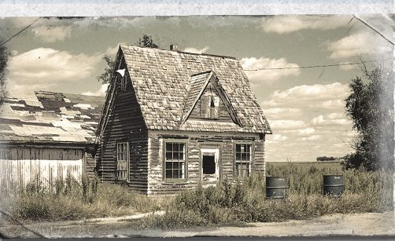

| Дом | Жильцы |
|---|---|
| 11 (продолжение) | помимо бухгалтерии, Эд служит городским оценщиком и ведает в Абаттуаре всем лицензированием и сбором налогов. |
| 13 | Этот дом давно брошен. Он ещё в приличном состоянии, на незапертой входной двери — выцветшая табличка «Скотт Браун пропертиз». |
| 14 | <u>Роберт Тейлор</u> (Cw) — см. «Последняя остановка» на с. 24. |
| 15 | <u>Мэтью Саттон</u> (F) — Мэтт — фармацевт под шестьдесят. Он подрабатывает в аптеке Келли и служит в городе уполномоченным по планированию и зонированию. Он среднего роста, стройный, с яркими чертами лица и аккуратными чёрными с проседью волосами. Он много общается с Вилли Кейном и разделяет его отношение к тому, что творится в городе. Мэтт, вероятно, знает о логове дастбилли больше любого другого постороннего и, если ПИ попросят, может дать им план этого места. |
| 27 | <u>Брайан Уэстбрук</u> (O) — см. «Прачечная „Саншайн“» на с. 26. |
| 29 | <u>Джейкоб Томсон</u> (O) — Джейкоб — пожарный на пенсии из Далласа, ему за восемьдесят. Он среднего роста, хрупкий, с грубыми чертами лица и короткими седыми редкими волосами. Жена умерла ещё до его переезда в Абаттуар. Он страстный филателист и служит в городе пожарным инспектором. |
| 31 | <u>Сэмюэл Мэй</u> (Af) — Сэмюэлу за тридцать, он банковский клерк и подрабатывает в Первом банке Абаттуара. Он невысокий и худощавый, с угловатыми чертами лица, аккуратными светлыми волосами и бледно-голубыми глазами. По ночам он сильно пьёт, чтобы не думать о том, что творится в городе, но на работу всегда приходит трезвым. Живёт он со своим псом Гризлом (дворняга средних размеров), который лает, когда кто-нибудь подходит к дому, и, если Сэмюэлу будут угрожать, будет защищать его до смерти. |
| 34 | <u>Джеральд Брюстер</u> (Cu) — см. «Свалка мусора Абаттуара» на с. 33. |
| 36 | <u>Ноа Кларк</u> (Af) — Ноа — рентгенолог на пенсии, ему около семидесяти пяти. Он очень маленький и коренастый, с мягкими чертами лица, аккуратными седыми волосами и тёмными светло-карими глазами. Его раздражают «хиппи», и он обожает политические споры. Ноа неравнодушен к хорошей еде и каждый месяц делает особые заказы в универсальном магазине Мэзерса. Живёт он со своим давним другом Лоуренсом Беллом.  <u>Лоуренс Белл</u> (Af) — Лоуренс — торговый представитель на пенсии под семьдесят. Он чуть ниже среднего роста, с тонкими заострёнными чертами лица, лысый, с голубыми глазами. Лоуренса (никогда не «Ларри») раздражает, что они с Ноа застряли в Абаттуаре; он предпочёл бы переехать в город, где есть «приличные рестораны».  Ноа и Лоуренс — пара, и вместе они уже больше сорока лет. На людях они постоянно ссорятся, думая, что так никто не догадается, что они пара, но от этого это только заметнее. Во многих маленьких городках это стало бы скандалом, но в таком месте, как Абаттуар, об этом стоит беспокоиться в последнюю очередь. |
| 37 | Этот дом много лет назад сгорел. Хозяин погиб в огне, близких родственников, судя по всему, не было, так что участок сейчас принадлежит городу. Платить за снос и вывоз никто не хочет, поэтому обгоревший остов так и стоит. |
| 39 | <u>Арчибальд «Арчи» Смит</u> (Cw) — см. «Парикмахерская Тома» на с. 23. |
| 52 | См. «Закусочная „Шоссе 6“» на с. 32. |

### Стил-роуд

| Дом | Жильцы |
|---|---|
| 6 | <u>Митчелл Оппенгеймер</u> (Af) — Митчу под тридцать, он скульптор. Он среднего роста и стройный, с грубыми чертами лица и растрёпанными светлыми волосами. Живёт он на страховую выплату после смерти родителей и почти всё время сваривает большие металлические скульптуры, которые стоят вокруг его дома, словно часовые. Митч регулярно покупает металлолом у братьев Винсент. Он знает, что они плохие парни, но не высовывается и занимается своими делами. Когда мимо проезжает машина, он всегда уходит в дом. Двери он укрепил металлом, так что его дом — один из самых надёжных в Абаттуаре.  Сам по себе Митчелл ничего предпринять не решится, но поможет любому, кто сопротивляется дастбилли, если это не слишком опасно. Ему нравится считать себя героем, и он может им стать, если сумеет преодолеть страх. |
| 20 | <u>Джон и Майкл Винсент</u> (Cw) — см. «Свалка братьев Винсент» на с. 32. |

*Прим. перев.: и здесь ссылки «см. с.» сдвинуты на 2 страницы: «Последняя остановка» — с. 26, «Прачечная „Саншайн“» — с. 28, свалка мусора — с. 35, парикмахерская Тома — с. 25, закусочная «Шоссе 6» и свалка братьев Винсент — с. 34.*

