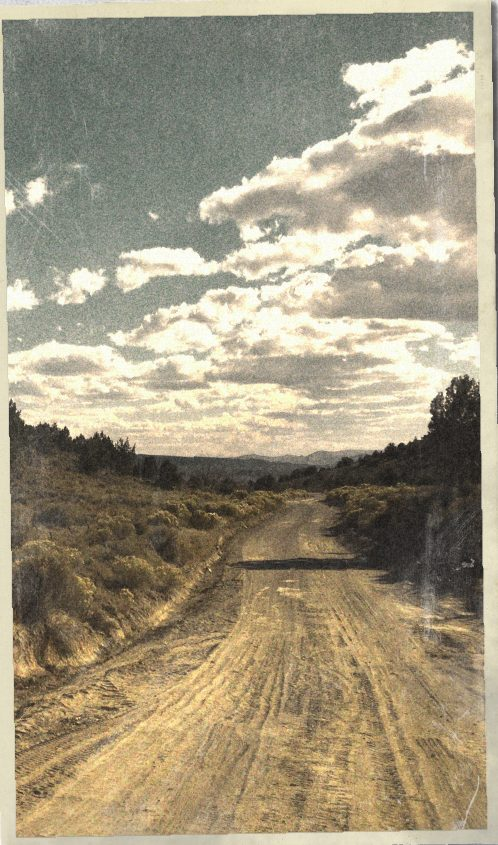

## 13b. Окрестные дороги

***Описание.*** *Грунтовые дороги, исчертившие окрестности Абаттуара, все более или менее одинаковы. Как правило, это укатанный гравий, наезженный и крайне непредсказуемый. Крутые повороты словно возникают из ниоткуда, а за следующим холмом незадачливый водитель может обнаружить овраг там, где когда-то была дорога. Рыхлые гравийные обочины могут осыпаться, и водитель уведёт машину в кювет. Внезапный паводок несколько месяцев назад мог снести один из бесчисленных деревянных мостиков через овраги и пересохшие русла. Куда эти дороги свернут дальше, понять невозможно — ни складу ни ладу.*

> **Ред-роуд**
>
> Первая (а может, и последняя) дорога, на которую попадаешь, выезжая из Абаттуара на восток, — Ред-роуд, хотя самодельный указатель сразу за городом называет её «Шоссе крови». Указатель сделали дастбилли, потому что именно с этой дороги начинаются их ритуальные охоты. Это самая оживлённая дорога в округе, и дастбилли знают её как свои пять пальцев. Если поискать в оврагах вдоль неё, особенно ближе к западному концу, наверняка найдутся бесчисленные стреляные гильзы, обломки машин, колпаки колёс, а иногда и брошенное оружие, которое заклинило не вовремя. Мало кто этим занимается — ведь обычно все заняты тем, что орут и гонят, спасая свою жизнь.
>
> **Дёрт-роуд**
>
> Эта короткая боковая дорога ведёт к Усадьбе и содержится довольно прилично. Вдоль восточной обочины тянется сточная канава, часто загаженная нечистотами из логова дастбилли.
>
> **Раттлер-роуд**
>
> Эта дорога заканчивается тупиком у глубокого оврага (Гремучего ущелья) в местах, которые дастбилли называют «Запретными землями». Ущелье получило своё название потому, что гремучих змей там обычно больше, чем где-либо.
>
> **Серпентс-роуд**
>
> Дастбилли дали дороге это название потому, что она ведёт к Змеиным пещерам, хотя мало кто знает, что на самом деле в этих пещерах.
>
> **Твистер-роуд**
>
> Эта извилистая дорога — одна из самых петляющих в округе, отсюда и название. Чуть больше чем в 8 км к западу дорога перегорожена старыми разбитыми машинами и валунами. Объехать завал на машине или съехать в пустыню невозможно.
>
> **Майнерс-роуд**
>
> Неудивительно, что эта дорога ведёт к шахтёрскому посёлку, а в конечном счёте — к старым шахтам «Уэйленд».
>
> **Ридж-роуд**
>
> Эта дорога пересекается с Майнерс-роуд в шахтёрском посёлке. Примерно в 2,4 км к югу дастбилли устроили яму-ловушку. Предупредить водителя о ловушке может только *трудная* проверка Внимания. Если машина влетит в неё на скорости, это будет всё равно что врезаться в кирпичную стену. Машина будет разбита, и, скорее всего, будут тяжёлые травмы.
>
> *Прим. перев.: на карте Хранителя (раздатка 3) эта дорога подписана «Eastridge Rd.» (Истридж-роуд); не путать с жилой Ридж-роуд в городе.*
>
> **Галли-роуд**
>
> Это сравнительно длинная прямая дорога, которая обрывается у оврага глубиной 10 м, где рухнул старый деревянный мост. Разумеется, его разрушили дастбилли, чтобы жертвы не могли уйти этим путём, но сделано это так давно, что понять это невозможно.
