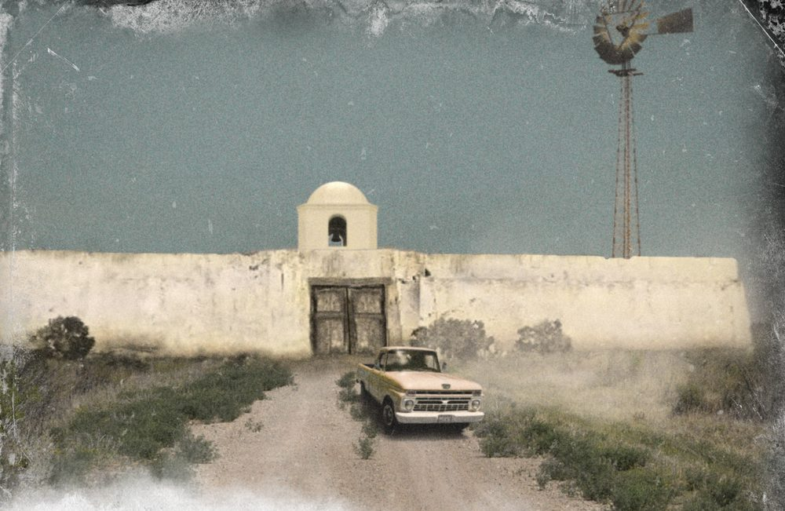

# Усадьба

## 14. Усадьба

***Описание.*** *Обнесённый трёхметровой адобовой стеной участок размером около 80×105 м больше похож на форт, чем на что-либо ещё. Снаружи видны лишь какая-то башня или шпиль в центре, промышленная ветряная мельница, возвышающаяся над стеной, и массивные ворота в короткой южной стене. Похоже, дастбилли построили на мельнице металлическую площадку 6×6 м примерно в 2,5 м под лопастями.*

> **Заметки Хранителя**
>
> Многие местные называют это место «Компаундом»; это святая святых культа Остина и дом большинства дастбилли. Ни один чужак, видевший Компаунд изнутри, не вернулся, чтобы его описать. Снаружи из внутреннего устройства видны только колокольня — надо полагать, какой-то церкви или молельного дома — и старая стальная ветряная мельница.
>
> Мельница когда-то снабжала округу водой — ещё до того, как сюда провели электричество, — но, когда ею перестали пользоваться, механизм проржавел и с тех пор не двигается. В некоторые ночи на ней разводят огромные костры, от которых верх мельницы почернел от маслянистой сажи. Кое-кто даже шепчет, что в ночи, когда на башне виден костёр, слышно эхо далёких криков.
>
> Единственный видимый вход — двустворчатые ворота высотой со стену и шириной около 5 м. Они сделаны из тяжёлых деревянных балок, образующих каркас, и обшиты гофрированной сталью. Как-то изнутри, видимо, можно смотреть наружу: ворота всегда открываются, когда подъезжает машина дастбилли.
>
> С восточной стороны Компаунда — дренажная канава. Под стеной проходит сточная труба диаметром около 1 м, по которой сточные воды отводятся от Усадьбы. Снаружи трубу закрывает стальная решётка, приваренная к её концу, но время и вода сильно её проржавили. Несколько хороших ударов ногой её выбьют (хотя шуму будет много), или её можно отжать ломом или похожим инструментом.
>
> Всего дастбилли 30; в Усадьбе в каждый момент находится от 20 до 30 из них — смотря сколько убито или в отлучке.
