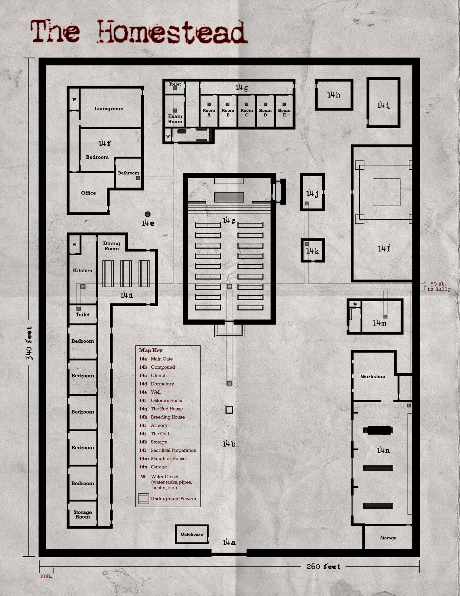

## Карта Усадьбы

*План Компаунда (размеры по краям — 260 × 340 футов, около 80 × 105 м; масштабная метка — 10 футов, около 3 м). Справа у стены — сточная труба с пометкой «50 ft. to Gully» (15 м до оврага). Подписи помещений: в доме Остина (14f) — Livingroom (гостиная), Bedroom (спальня), Bathroom (ванная), Office (кабинет); в Красном доме (14g) — Toilet (туалет), Exam Room (смотровая), Room A–E (комнаты A–E); в общежитии (14d) — Dining Room (столовая), Kitchen (кухня), Toilet (туалет), Bedroom (спальни), Storage Room (кладовая); у ворот — Gatehouse (сторожка); у гаража (14n) — Workshop (мастерская) и Storage (склад).*

**Ключ карты**

| № | Место |
|---|---|
| 14a | Главные ворота |
| 14b | Двор |
| 14c | Церковь |
| 14d | Общежитие |
| 14e | Колодец |
| 14f | Дом Остина |
| 14g | Красный дом |
| 14h | Дом размножения |
| 14i | Арсенал |
| 14j | Камера |
| 14k | Склад |
| 14l | Подготовка жертв |
| 14m | Бойня |
| 14n | Гараж |
| W | Технический чулан (баки с водой, трубы, водонагреватель и т. п.) |
| ▭ | Подземная канализация |
