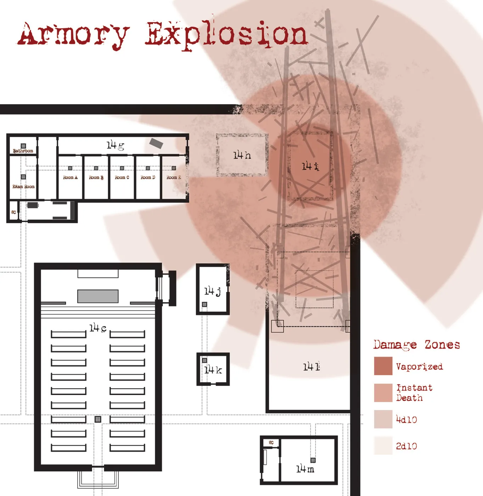

> камера (E) Красного дома будет проломлена: всякий, кто внутри, с вероятностью 30 % погибнет сразу, а иначе получит 2d6 урона. Весь северо-восточный угол внешней стены будет разрушен — на 20–25 м в каждую сторону.
>
> Всякий в пределах 15 м от взрыва, кого не защищает стена, гибнет мгновенно. Всякий, кто от 15 до 30 м, проходит проверку ВЫН: при успехе он получает 1d6 урона от контузии, при провале — 2d6. Грохот взрыва будет слышен за много километров, а сам взрыв будет виден из Абаттуара, шахтёрского посёлка и от Змеиных пещер.



*Прим. перев.: на схеме для внешних зон указан урон 4d10 и 2d10, а в тексте — 1d6 или 2d6 по проверке ВЫН.*

**Существа.** В тени за оружейными стойками и ящиками с патронами прячутся восемь (8) Детей Йига. Эти огромные гремучие змеи — от 4 до 5 м длиной и толщиной с человеческую руку. В отличие от обычных здешних гремучников, эти твари заметно крупнее, в сотню раз ядовитее и подчиняются Остину, мгновенно исполняя его приказы. Сейчас им велено охранять арсенал.

Через раунд после того, как сыщики войдут в арсенал, они услышат характерный треск погремушек и шорох огромных гремучих змей. В зависимости от обстоятельств Хранитель может дать первому сыщику проверку ЛВК, чтобы выскочить в дверь, если он захочет, — но если кто-то стоит прямо за ним, это невозможно.

Детей Йига можно удержать на расстоянии, если поднять перед ними Знак Старших богов и пройти проверку МОЩ. Её нужно повторять каждый раунд, чтобы змеи держались в стороне, и защищает она только того, кто держит знак.

```stat
Дети Йига

хар.    средн.   бросок
СИЛ     40       (2d6+2)×5
ВЫН     40       (2d6+2)×5
ТЕЛ     20       (1d6+2)×5
ЛВК     95       (5d6+2)×5
МОЩ     55       (3d6+2)×5

ПЗ: 8
Средний бонус к урону: нет
Средняя Комплекция: 0
Скорость: 8

АТАКИ
Атак за раунд: 1 (Укусом может контратаковать много раз за раунд)
Ближний бой (укус): змея появляется так стремительно, что жертва всегда застигнута врасплох и укушена автоматически, если только не успеет среагировать (игрок должен пройти проверку ЛВК или ИНТ). В следующих раундах сыщик должен успешно Уклоняться, чтобы змея его не укусила: она будет преследовать его и атаковать, пока её не убьют. Никакое противоядие не спасёт того, кого укусила священная змея Йига: после нескольких минут агонии укушенный всегда умирает.
Хотя эти змеи крупнее своих сородичей, никаких сверхъестественных или необычных способностей или сил, например заклинаний, у них нет. Обычно вид священной змеи Йига не стоит Рассудка, хотя при виде большого клубка извивающихся змей Хранитель может потребовать потерю 0/1 Рассудка.

Броня: нет
Навыки: Скрытность 90%
Потеря Рассудка: особая (см. выше)
```

*Прим. перев.: так в оригинале — ПЗ 8 (по формуле (ВЫН 40 + ТЕЛ 20) / 10 = 6); при СИЛ + ТЕЛ = 60 бонус к урону и Комплекция должны быть −2, а не «нет» и 0.*

## 14j. Камера

**Описание.** Низкое строение из шлакоблоков примерно 5 × 8 м, с плоской крышей из бетона, укреплённого сталью. Посередине длинной восточной стороны на крепких петлях висит дверь из стального листа размером 1 × 2 м. Она запирается стальным засовом толщиной 2,5 см с крепким навесным замком.

**Описание помещений.** Едва дверь откроется, отвратительное зловоние заставит всякого, кто его не ждёт, мучительно давиться. Это сильный металлический смрад, смешанный с запахом гнилого мяса, мочи, кала и сырой затхлости. Единственный свет — из щели в 1 см под дверью. Он освещает простые бетонные ступени, спускающиеся на 1 м к полу, но больше снаружи почти ничего не разглядеть.

Когда глаза пленника привыкнут к темноте, он увидит, что бетонный пол покрыт скользким слоем гниющей органики. Тёмная куча у западной стены похожа на груду старой одежды, одеял, обуви и
