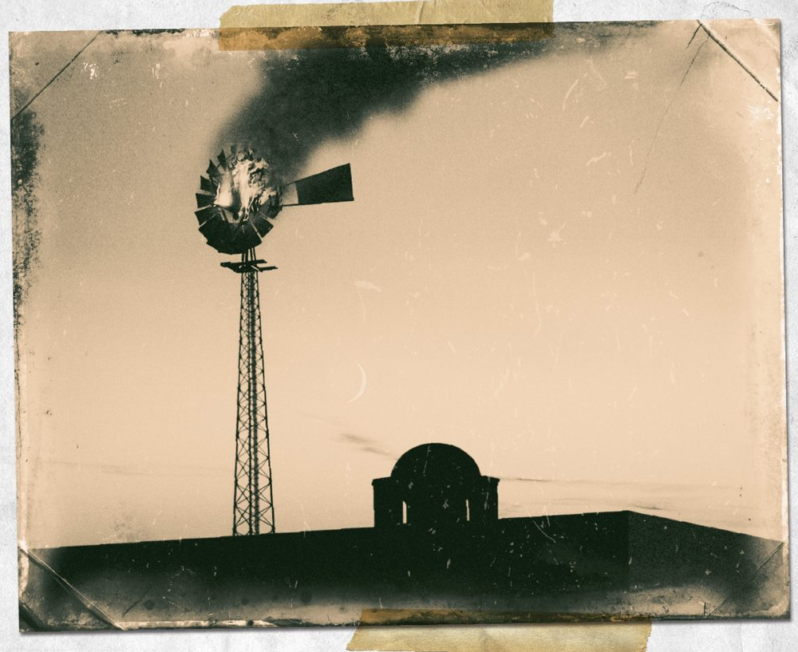

В северной стене — широкий проём в мастерскую: здесь ленточная пила, сверлильный станок, сварочное оборудование, ацетиленовая горелка и прочее оборудование для металлообработки. У северной стены — тяжёлый стеллаж с разным стальным прутом, уголком, арматурой и другим сырьём. В юго-западном углу мастерской стоит старое коричневое кресло-качалка с откидной спинкой.

В восточном конце южной стены — одна дверь с надписью по трафарету «storage» («склад»). За незапертой дверью — комната 5 × 10 м со стеллажами запчастей для разных машин дастбилли, а также банками масла и смазки.

**Примечательные предметы.** Здесь есть все инструменты обычной автомастерской, а также материалы, чтобы изготовить металлические детали с нуля. Любой, кто пользуется этим оборудованием, получает бонусную кость к подходящей проверке навыка.

**Персонажи Хранителя.** *Кутер.* Старина Кут — редкий пожилой дастбилли, у которого хватает мозгов, чтобы удержать в голове, как чинить машины и работать с металлом. На вид Куту под семьдесят: клочковатые седые волосы, руки в шрамах и искривлённый позвоночник, из-за которого он навсегда сгорбился. Один глаз много лет назад обожгло брызгами аккумуляторной кислоты, и он навсегда помутнел.

Кутер — дастбилли второго поколения, и людоедские дни у него позади, хотя он по-прежнему преданный последователь Остина. Он часто спит в старом кресле в мастерской: тишина мастерской ему милее буйного шума общежития.

