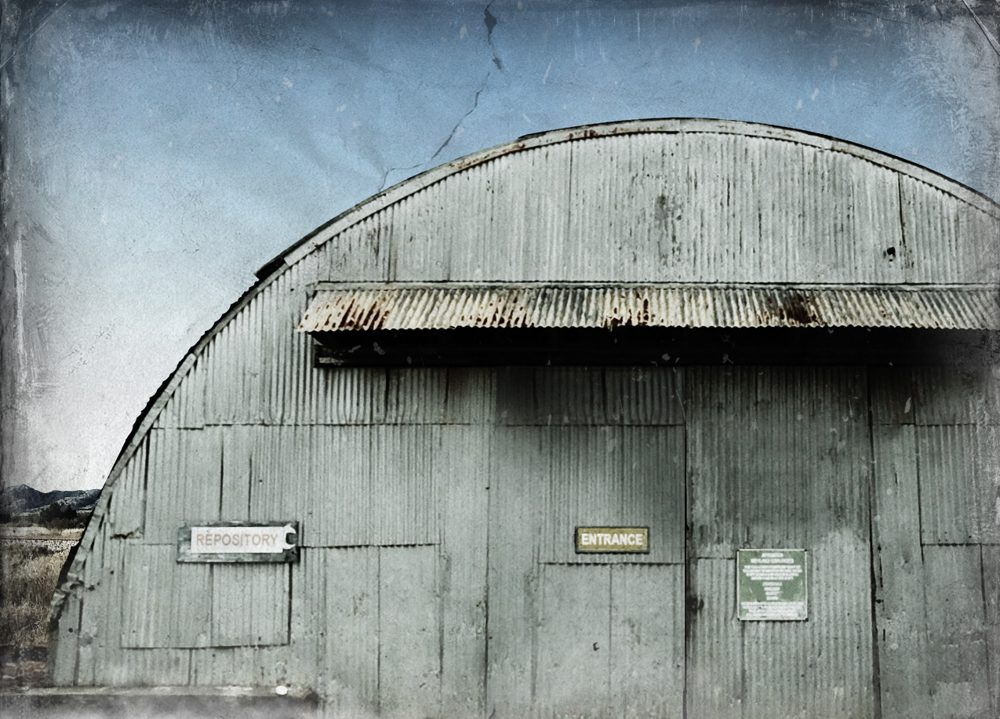

# Старый шахтёрский посёлок

## 15. Старый шахтёрский посёлок

**Описание.** На пересечении Майнерс-роуд и Ридж-роуд (на карте — Истридж-роуд) стоит небольшая кучка домов и построек. Среди них больше тридцати маленьких домиков-коттеджей и несколько зданий покрупнее, явно принадлежавших ныне не существующей горнодобывающей компании «Уэйленд»: контора, клуб, душевые и здание для снаряжения, называемое «Репозиторий». Почти всю землю поглотила пустыня, но многие постройки, похоже, более-менее целы (раздатка 14).

> **Заметки Хранителя**
>
> Если сыщики проведут в шахтёрском посёлке больше десяти минут, Хранителю стоит дать им проверки МОЩ. При успехе у сыщика возникает чувство, что за ними наблюдают. Это Грейди следит за ними из одного из ближних коттеджей. Он привык прятаться от дастбилли, так что заметить его можно только при чрезвычайной проверке Внимания.

## 15a. Контора горнодобывающей компании «Уэйленд»

**Описание снаружи.** Каркасное деревянное здание на удивление хорошо пережило непогоду. Оно одноэтажное, крыто асфальтовой черепицей, в нём два окна под защитными металлическими сетками и одна дверь. Вывеска над входом гласит:

> **Weyland Mining Co.**
> **Public Office**
> **AUTHORIZED PERSONNEL ONLY**
>
> (Горнодобывающая компания «Уэйленд». Контора для посетителей. ТОЛЬКО ДЛЯ ПЕРСОНАЛА)

Крепкая деревянная дверь заперта на ржавый навесной замок, а окна занавешены, так что внутри ничего не видно. Замок слишком проржавел, чтобы его вскрыть, но сломать его нетрудно: несколько сильных ударов чем-нибудь вроде молотка сорвут петлю.

**Описание помещений.** Сразу за дверью — главная контора: три стола, шесть картотечных шкафов и большая карта
