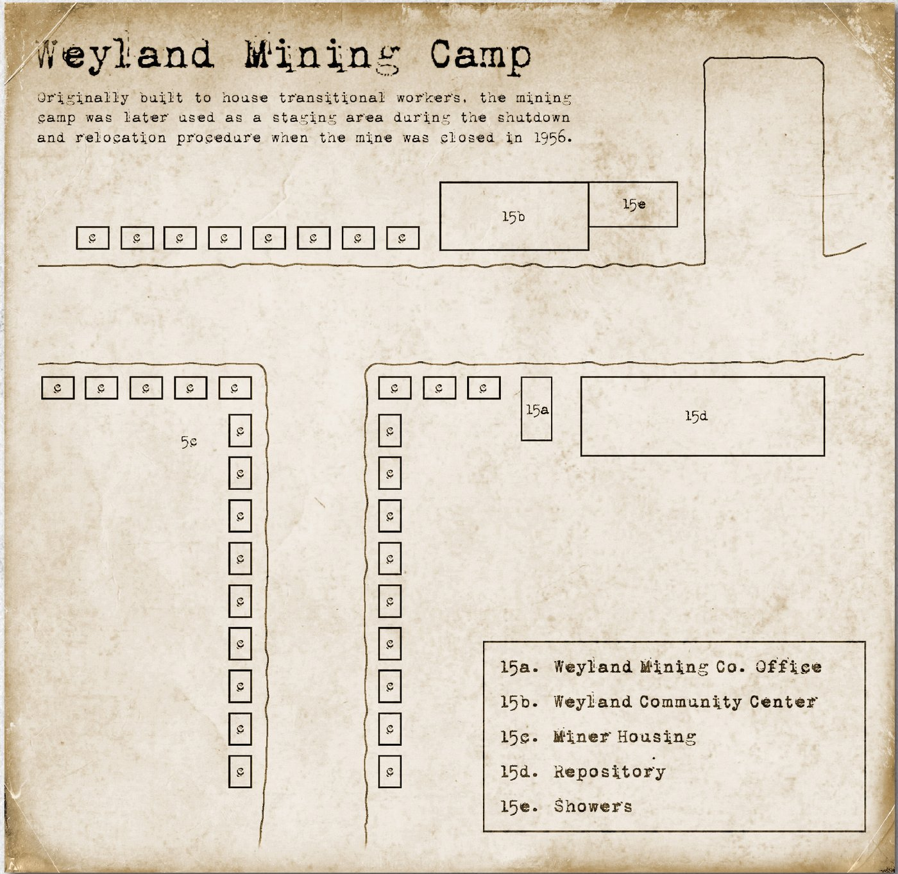

> Однако крысы, живущие здесь, десятилетиями ели, дышали и плодились в этой ядовитой среде. Радиация вызвала тревожные мутации: крысы стали крупнее, облысели, покрылись язвами, у них выросло несколько лишних пар бескостных лап. Затронута и их центральная нервная система, так что твари крайне агрессивны. Всякого, кто подойдёт к полке ближе чем на метр-другой, облепит стая из десяти крыс размером с кошку. У этих жутких раздутых тварей, покрытых опухолями, красные глаза, бледная плоть и десятки бьющихся отростков (см. «Стая крыс-мутантов» в приложении IV).

**Примечательные предметы.** Под прилавком — старый счётчик Гейгера с давно севшей батарейкой. Он заработает от стандартных батареек типа D, какие ставят в большинство больших фонарей.

**Персонажи Хранителя.** Здесь никого нет, кроме крыс-мутантов.

## 15e. Душевые

**Описание.** К клубу пристроено здание из шлакоблоков с надписью по трафарету над входом: Hot Showers («Горячий душ»). Дверь валяется рядом на земле. Внутри видны десятки душевых кабинок вдоль стен. Души больше не работают.

**Шахтёрский посёлок «Уэйленд».** *Построенный для временных рабочих, посёлок позже служил перевалочной базой при остановке и переезде, когда шахту закрыли в 1956 году.*

- 15a. Контора горнодобывающей компании «Уэйленд»
- 15b. Клуб «Уэйленд»
- 15c. Дома шахтёров
- 15d. «Репозиторий»
- 15e. Душевые
- Grady’s Place — дом Грейди
