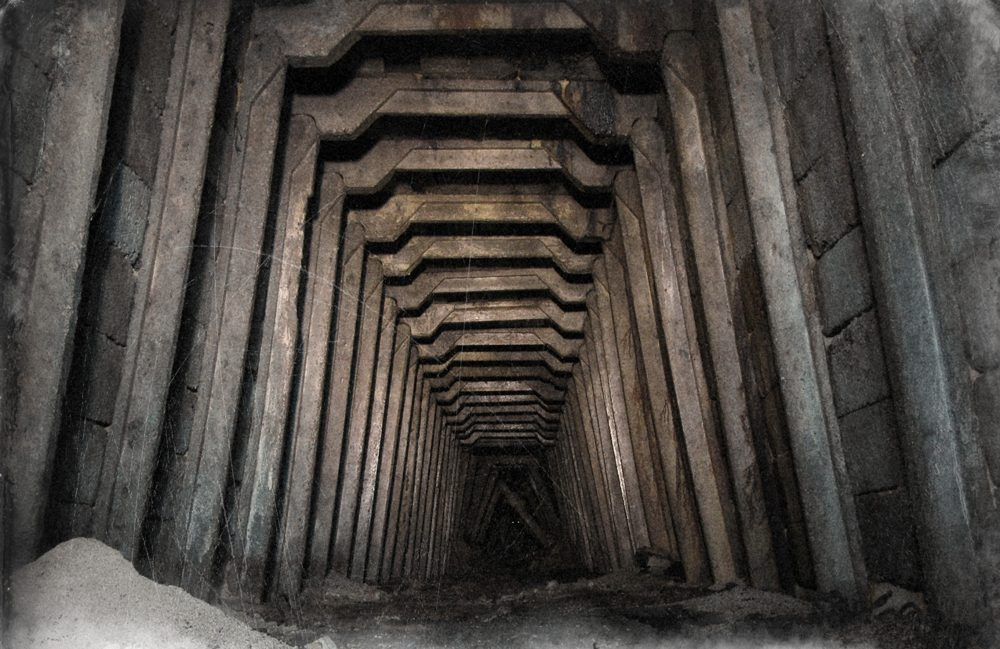

# Шахты «Уэйленд»

## Общее описание

Вы проходите сквозь покосившуюся сетчатую ограду с выцветшими табличками, предупреждающими о радиации, и сломанными воротами — и становится ясно, что это мёртвая зона. Ни растений, ни насекомых, ни других признаков жизни. Лишь изредка над головой пролетает хищная птица, но, похоже, даже птицы облетают это место стороной. Воздух пропитан резким едким химическим запахом, который першит в горле и щиплет глаза.

Несколько низких бетонных построек похожи на гробницы, а разбросанные трубы торчат из земли, словно железные кости. Землю избороздили глубокие перекрещивающиеся следы экскаваторов, которые не смогли стереть десятилетия ветров и дождей.

Выше, на склоне холма к северу, в земле прорезаны чёрные, примерно прямоугольные отверстия. Ветер, задувая в них, издаёт низкий стон, наводящий на мысль о погибших душах, отдавших жизнь этому богом забытому месту. По бокам от входов — груды дроблёной породы, а среди обломков кое-где видны опрокинутые вагонетки. На первый взгляд открытых штолен три (раздатка 17).

> **Заметки Хранителя**
>
> Компания «Уэйленд» вела добычу сочетанием подземного способа и подземного выщелачивания. Площадки подземного выщелачивания расположены на склоне ниже входов в подземные штольни. Это насосные установки, химические резервуары и бензиновые насосы. При таком способе добычи воду и некоторые химические соединения закачивают через скважины, пробуренные в залежь, а затем извлекают искусственно растворённый уран. В результате почти все грунтовые воды в округе заражены тяжёлыми металлами и радиацией. Эти площадки выщелачивания — и источник неприятного запаха.
>
> Подземные штольни — такие, какими обычно и представляют себе шахту. Туннели спускаются под углом 15 градусов, а метров через 60–90 выравниваются. Иногда туннель может пойти вниз или вверх — в зависимости от содержания руды в породе или чтобы обойти естественные скопления грунтовых вод. Размеры штолен немного разнятся, но обычно они 2,5–3 м в ширину и 3 м в высоту.
>
> Когда шахту закрыли, почти всё оборудование вывезли. Остались лишь несколько деревянных погрузочных площадок, шесть бетонных хранилищ (пустых) и несколько вагонеток.
