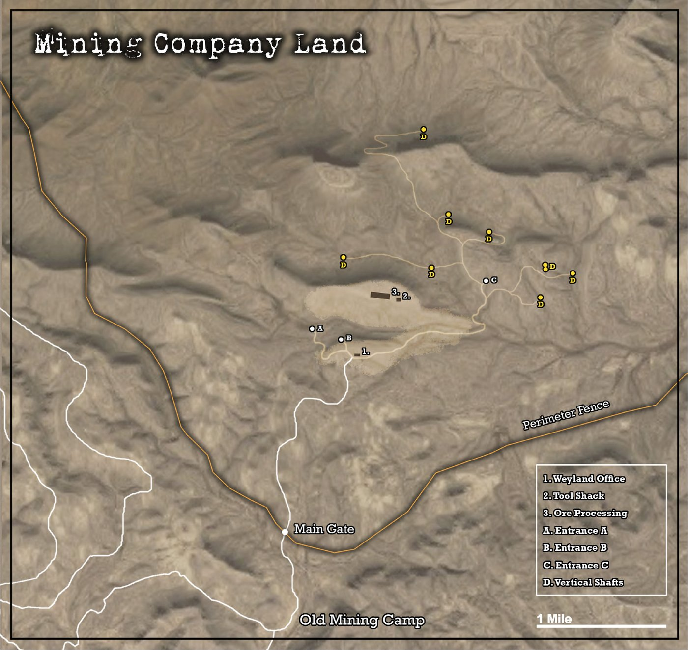

**Земли горнодобывающей компании.** Ключ карты:

- 1 — Контора «Уэйленд»
- 2 — Инструментальная будка
- 3 — Рудообогатительная фабрика
- A — Вход A
- B — Вход B
- C — Вход C
- D — Вертикальные стволы

Подписи на карте: Perimeter Fence — ограда по периметру; Main Gate — главные ворота; Old Mining Camp — старый шахтёрский посёлок; масштабная линейка — 1 миля (1,6 км).

## 1. Контора «Уэйленд»

**Описание.** От этого почерневшего строения осталась лишь выгоревшая коробка с покоробленной ржавой металлической крышей. О прежнем назначении говорит только обугленная вывеска, криво висящая на фасаде: Weyland Mining Co. — Main Office («Горнодобывающая компания „Уэйленд“ — главная контора»).

> **Заметки Хранителя**
>
> Беглый осмотр помещения позволит заметить несколько почерневших канистр из-под керосина. Проверка Внимания обнаружит остатки открытой зажигалки — становится ясно, что кто-то сжёг это здание десятки лет назад. Больше ничего интересного здесь нет.

## 2. Инструментальная будка

**Описание.** Похоже, когда-то здесь хранилось кое-что из самого дорогого шахтного оборудования, но, когда шахту закрыли, будку давно опустошили. Осталась лишь деревянная коробка с восемью пыльными шахтёрскими касками и сломанная кирка.

> **Заметки Хранителя**
>
> Лампы на касках, похоже, исправны, но в них кончилось топливо. Сыщики могут заправить их чем-то другим, например бензином или лампадным маслом, хотя бензин опасен и при повреждении может вспыхнуть (на усмотрение Хранителя).
