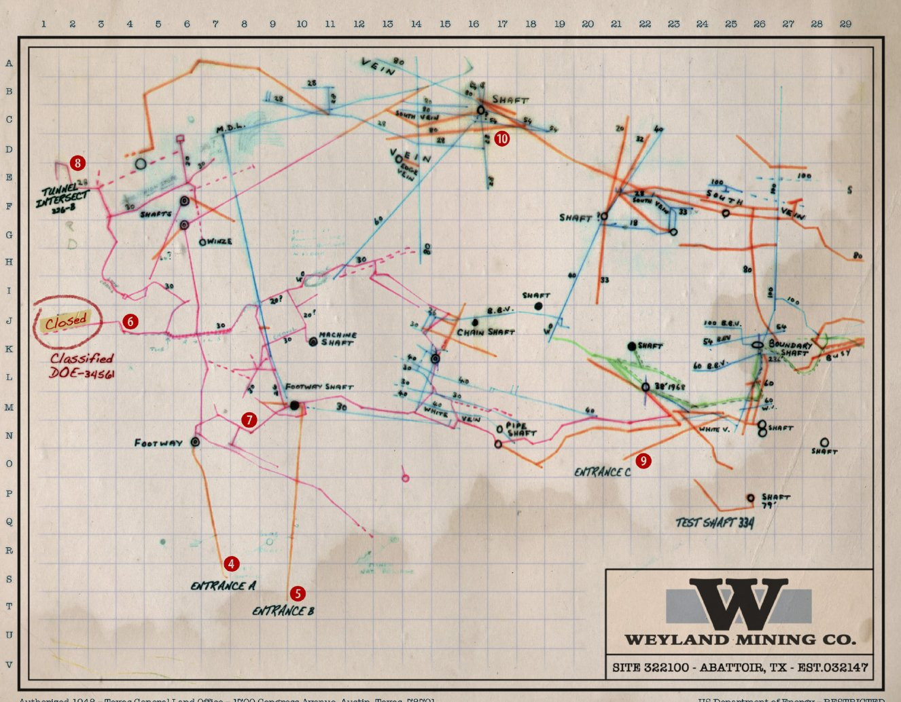

## Карта штолен (для Хранителя)

> **Ключ карты**
>
> *Синие линии.* Эти туннели частично или полностью затоплены. Вода, вероятно, радиоактивна (см. приложение).
>
> *Кружки.* Кружки — вертикальные стволы диаметром 60 см. Одни предназначались для отвода газов (Pipe Shaft — трубный ствол), другие — для подачи свежего воздуха шахтёрам (Shaft — вентиляционный ствол), третьи — для спуска оборудования (Machine Shaft — машинный ствол) или снаряжения (Chain Shaft — цепной ствол). Стенки у них довольно гладкие, хотя подняться по стволу можно, пройдя 1d4 успешных проверки СИЛ.
>
> *Зелёные линии.* Эти туннели — узкие пробные выработки. В них всего около 1 м в ширину и 2 м в высоту, крепи нет. Они легко обрушиваются, особенно если их потревожить.
>
> *Оранжевые линии.* В этих туннелях проложены рельсы для вагонеток. Они были нужны, чтобы быстрее перевозить руду между рудными туннелями и наземными сооружениями.
>
> *Розовые линии.* Эти туннели — либо разведочные выработки, либо места, где добывали руду.
>
> *Масштаб.* Каждая клетка карты — примерно 150 м.

## 3. Рудообогатительная фабрика

**Описание снаружи.** Самое большое здание на территории: бетонные стены и крыша из профнастила, сильно изъеденная ржавчиной. Стальные раздвижные двери закрыты и заперты на огромный навесной замок. Металлическая табличка над замком гласит: WARNING: CONTAMINATED AREA («ВНИМАНИЕ: ЗАРАЖЁННАЯ ЗОНА»), а ниже — Access Prohibited by order of the U. S. Department of Defense («Доступ запрещён распоряжением Министерства обороны США»). Через каждые метр-два вдоль наружной стены висят ещё ярко-жёлтые предупреждающие таблички: DANGER: RADIATION («ОПАСНО: РАДИАЦИЯ»).

> **Заметки Хранителя**
>
> Если у кого-то есть исправный счётчик Гейгера, он обнаружит, что от здания исходит высокий уровень радиации.

**Описание помещений.** Когда-то здесь, очевидно, стояло оборудование для размола урановой руды в мелкий порошок перед дальнейшей очисткой. Низкие прочные помосты отмечают, где раньше стояли дробилки.
