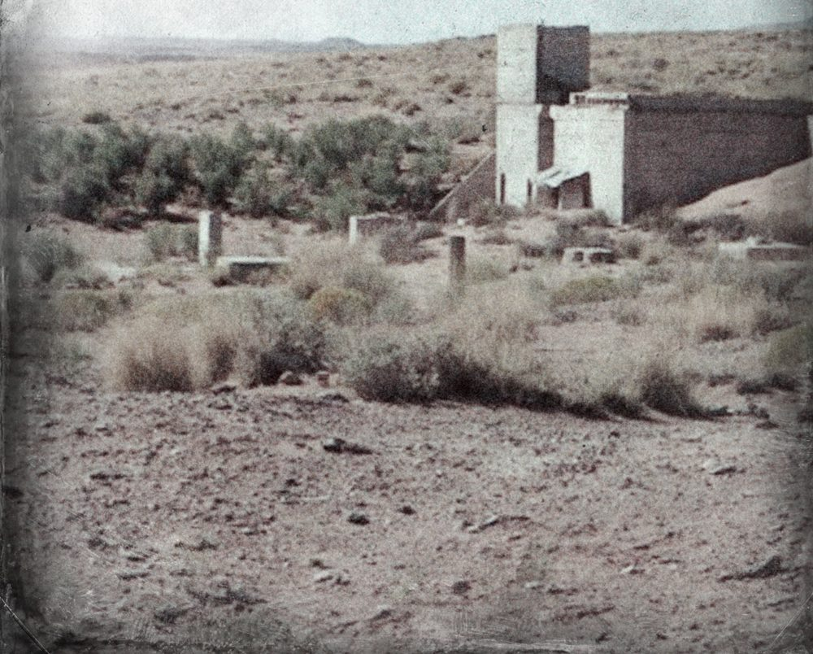

позволяла поднимать и опускать вагонетки по стволу. Довольно очевидно, что сейчас она не работает, хотя к ней всё ещё привязан толстый канат, уходящий во тьму. Уклон — около двенадцати градусов, пройти по нему пешком нетрудно, а канат даёт дополнительную опору. Метров через тридцать штольня затоплена чёрной стоячей водой.

> **Заметки Хранителя**
>
> Это разведочная штольня, которую начали вскоре после основной. Ранние пробы керна говорили о том, что в этом направлении есть ещё залежи урана. Правда ли это, выяснить так и не удалось. Когда пробили с десяток выработок, прорвались в подземный резервуар сильно радиоактивной воды, затопившей этот участок шахты. Затопленные участки на карте отмечены оранжевым. Вода сильно радиоактивна (см. приложение).

*Прим. перев.: в ключе карты (с. 59) затопленные туннели обозначены синими линиями, а оранжевыми — туннели с рельсами.*

## 10. Последняя выработка

Самые новые туннели ведут к этому перекрёстку штолен. Похоже, дойдя сюда, горняки пытались вести штольни во множестве разных направлений. Все они упираются в глухую стену с нарисованным оранжевым «X». В нескольких штольнях на полу стоит тёмная маслянистая вода глубиной под метр.

> **Заметки Хранителя**
>
> Это последние туннели, проложенные компанией «Уэйленд». Уже шли разговоры о закрытии шахты, но была сделана последняя отчаянная попытка найти новую рудную жилу. К несчастью, горняки прорвались в ещё один заражённый резервуар, и многие туннели затопило радиоактивной водой глубиной до 1 м (см. приложение).

