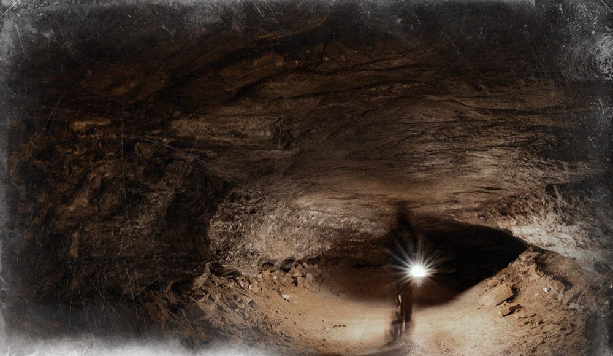

# Змеиные пещеры

## 1. Вход в пещеры

Серпентс-роуд словно растворяется метрах в тридцати от крутого обрыва. Вокруг валяются несколько десятков брошенных машин, некоторые ещё начала 1900-х годов. Все они сильно изъедены непогодой и, похоже, сожжены.

На фоне светлого песчаника вокруг выделяется чёрная расселина шириной 2 м и высотой 4 м. По обе стороны от неё стоят два грубых обелиска из песчаника. Каждый шпиль — около 1 м высотой, и в каждый вделано кольцо из тёмного металла.

> **Заметки Хранителя**
>
> Присмотревшись к обелискам, можно понять, что когда-то на них были какие-то надписи или изображения, но время и непогода сделали их неразборчивыми. Металлические кольца — около 15 см в диаметре; они выкованы из материала, похожего на кованое железо, но гораздо легче. Если к кольцу прикоснуться, оно бьёт сильным разрядом тока со слышимым треском.

## 2. Змеиное гнездо

Уходящий вниз известняковый проход загромождён сталагмитами и сталактитами. По проходу поднимается чуть более тёплый воздух, а с ним — тошнотворно-сладкий запах, который застревает в горле и оставляет дурной привкус. Проход выходит в большую сводчатую пещеру шириной 50 м. Пол покрыт толстым слоем гниющих растений и костей. В центре — впадина в 10 м, выстланная каким-то песком или порошком. Вокруг впадины разбросаны остатки девяти огромных яиц. Среди останков распростёрлось мёртвое тело огромной змеи. Бо́льшая часть её, похоже, съедена, а в самом толстом месте тело не меньше 60 см в поперечнике.

> **Заметки Хранителя**
>
> Проверка Естествознания покажет, что змея была длиной до 15 м. Трудный успех покажет, что, когда она умерла, ею, скорее всего, кормились остальные обитатели гнезда. Если сыщики решат обследовать гнездо, проверка Внимания найдёт останки десятков койотов и почти стольких же людей.
>
> Если сыщики ещё не встречали гигантских змей, они проходят проверку Рассудка (0/1d3).

## 3. Пересечение с шахтой «Уэйленд»

Штольня выходит в естественную пещеру размером 20 м. Сразу у входа в пещеру пол завален каменными обломками и разным шахтным оборудованием: несколько касок, пневматический бур, две кирки и лежащая на боку рудная вагонетка.
