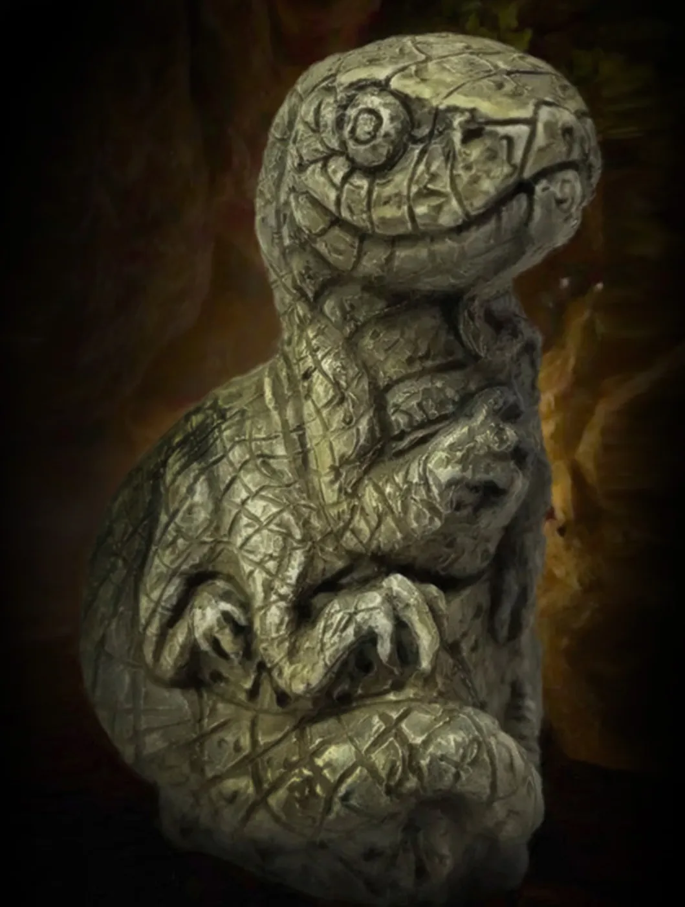

> **Заметки Хранителя**
>
> Если сыщики сдвинут часть камней, они найдут скелеты нескольких шахтёров. Успешная проверка Медицины покажет, что перед смертью у всех них были переломаны многие кости. Проверка Внимания найдёт водительские права 1956 года на имя Уильяма Кэлхуна, Ридж-роуд, 12, Абаттуар, штат Техас.

## 4. Галерея крыс-мутантов

Туннель расширился в подобие галереи с потолком выше 25 м. Сталагмиты и сталактиты окрашены отложениями железа в тёмно-красный цвет, сильно пахнет серой (раздатка 19).

> **Заметки Хранителя**
>
> Проверка Слуха позволит сыщикам услышать шуршание и топоток и тонкий писк, напоминающий летучих мышей. Когда сыщики дойдут до середины зала, из нор в известняке хлынут стаи крыс-мутантов (см. «Стая крыс-мутантов» в приложении). Хранителю стоит дать сыщикам достаточно предупреждений, чтобы они успели убежать: эта встреча нужна скорее для того, чтобы вызвать у сыщиков отвращение и заставить их двигаться дальше. Если сыщики видели крыс в «Репозитории», возможно, они узнают звук. Иначе у них будет три раунда, прежде чем стаи до них доберутся. Далеко крысы за ними не погонятся, так что дайте сыщикам несколько напряжённых раундов и, может быть, возможность получить пустячный укус.

## 5. Старые останки

Туннель упирается в тупик. Вы уже собираетесь повернуть назад, когда замечаете блеск за выступом скалы. Присмотревшись, вы видите скелет человека, свернувшегося клубком. Одежда висит на нём лохмотьями, а в руках он сжимает большую книгу в кожаном переплёте.

> **Заметки Хранителя**
>
> Осмотрев его, сыщики поймут, что одежда на нём — середины XIX века. Книга у него в руках — истлевающая Библия, сильно разложившаяся и обгрызенная по краям. На костях видны следы мелких зубов, как у грызунов. На самом деле больше ста лет назад его сожрала стая крыс. Зачем он пришёл сюда — загадка.

## 6. Святилище Йига

Туннель заканчивается гладко вырезанной полусферой. Из сталагмита вырезано подобие постамента, на котором стоит маленькая статуэтка из серо-зелёного камня. Идол — всего около 6 см высотой и изображает шестирукого двухвостого змея (раздатка 20).

> **Заметки Хранителя**
>
> Всякий, кто подойдёт к идолу, заметит, что от него исходит слабое тепло. В руке он тёплый на ощупь (чуть теплее тела). Тот, кто держит идол, сможет держать тейхиихан на расстоянии, хотя передать эту защиту спутникам не сумеет… если, конечно, не отдаст им идол. Если тот, кто держит идол, нападёт на тейхиихан, идол больше не будет их сдерживать и они нападут на держащего, но со штрафной костью.
>
> Прямо за постаментом трудная проверка Внимания обнаружит искусно скрытую дверь. Она вырезана из дерева и покрыта известняком так, что точь-в-точь совпадает со стеной. Когда дверь найдена, легко определить, что она открывается наружу. За ней — высеченная в скале лестница шириной 1,5 м, спускающаяся на 15 м к туннелю, явно проложенному разумными существами. Туннель идёт почти идеально прямо до такой же лестницы в дальнем конце. Она поднимается к двери, ведущей в Храмовый комплекс (15e). Со стороны храма дверь не скрыта.

> **Заметки Хранителя**
>
> На этом изображении — настоящая статуэтка «Идол Йига», которую изваял Джейсон Маккитрик из мастерской Cryptorium на Etsy. Пожалуйста, загляните в его магазин и купите идол — это потрясающий реквизит для вашей игры!
>
> https://www.etsy.com/listing/657037512/idol-of-yig
