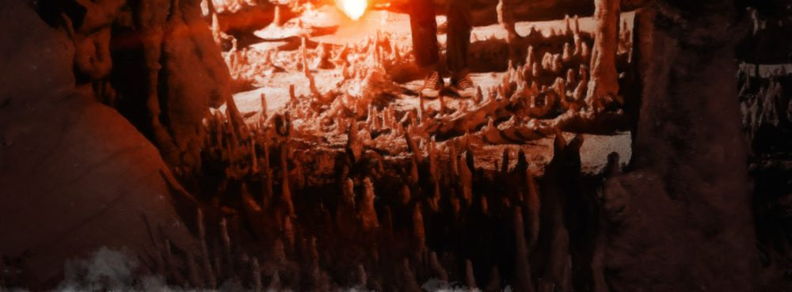

## 7. Грибной собор

Туннель, похожий на собор, уходит во тьму. Как и в других местах пещерной системы, здесь известняковые колонны и бесчисленные сталагмиты и сталактиты поменьше, но, в отличие от других мест, каждая поверхность покрыта жёлтыми и белыми грибными наростами. Грибы — от нескольких сантиметров в поперечнике до метра-двух на некоторых огромных белых колоннах. Туннель спускается к гладкому белому полу, покрытому несколькими сантиметрами молочно-мутной стоячей воды.

Размеры туннеля трудно оценить, но он наверняка больше 30 м в ширину, а потолок — почти вдвое выше. Несмотря на размеры, звук здесь не отдаётся эхом: всё облеплено толстыми слоями бледных грибов.

> **Заметки Хранителя**
>
> Трудная проверка Слуха позволит услышать в туннеле слабое хлюпанье, но чтобы определить, откуда оно, нужен чрезвычайный успех. На самом деле звук идёт отовсюду. Его издают бесчисленные полупрозрачные красные черви, прогрызающие себе путь сквозь грибную массу. Если кто-то отломит кусок гриба, из него вырвется облако красноватых спор и червей и осыплет сыщика и тем и другим. Холодные черви тут же начинают зарываться в одежду — это требует проверки Рассудка (1/1d4).
>
> На самом деле черви безвредны для животных, но споры при вдыхании могут быть опасны. Сыщик, которого угораздило покрыться спорами, проходит проверку ВЫН. При провале он вдохнул хотя бы часть спор, и они почти сразу начинают приживаться в тёплом влажном нутре его тела. В течение часа у него появляется хриплый кашель, а через шесть часов — головокружение. Грибок задушит его в течение 24 часов, если только он не сумеет подставить себя яркому солнечному свету и жаре. Грибок крайне чувствителен и к тому и к другому и погибает меньше чем через тридцать минут после того, как жертва окажется под палящим солнцем.

## 8. Норы хтонийцев

В стене туннеля — несколько странно симметричных круглых отверстий, каждое около 1,5 м в диаметре. Прямо под каждым — куча раскрошенного камня, и ещё больше каменной пыли заполняет нижнюю треть каждого небольшого туннеля. Изнутри доносится слабый звук, будто что-то извивается.

> **Заметки Хранителя**
>
> В стенах этого туннеля живут три молодых хтонийца. Недавно жрица начала растить их в стражи, но им меньше 10 лет, и по меркам хтонийцев они ещё совсем малы.
>
> Они чувствуют, когда в туннеле появляются мыслящие существа, и тут же приползут выяснить, в чём дело. Если сыщики уйдут в течение примерно тридцати секунд, хтонийцы за ними не последуют, а вернутся к рытью нор.

## 9. Перекрёсток

Здесь пересекаются четыре туннеля покрупнее, и выбрать направление трудно. Подумав мгновение, вы вдруг понимаете, что не вполне уверены, из какого туннеля пришли.

> **Заметки Хранителя**
>
> Этот перекрёсток обладает особым свойством — он сбивает с толку в выборе направления. Сыщики могут пройти проверки МОЩ, чтобы заметить, что с этим местом что-то не так. Если кто-то не пожалеет времени и обыщет окрестности, трудная проверка Внимания позволит определить, по какому проходу они пришли, — тогда его можно пометить. Если его как-то не пометить, это быстро снова забудется. Чрезвычайный успех проверки Внимания обнаружит у прохода, ведущего к месту 13, вещь одной из жертв тейхиихан. Если сыщики ищут кого-то конкретного, это должна быть вещь, которую они узнают. Иначе это должно быть что-то побуждающее к действию — например, женская туфля или детский плюшевый мишка.
