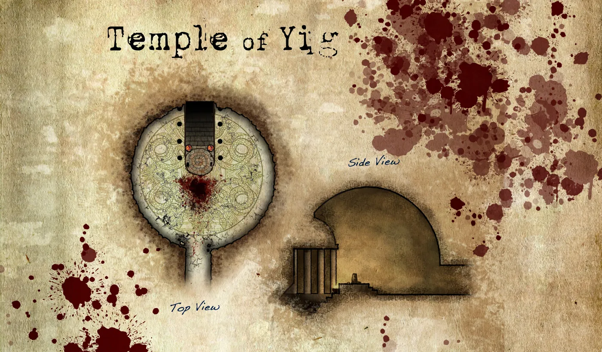

> Иначе она призовёт тейхиихан, чтобы те преградили сыщикам выход из здания. Между её приглашением и появлением тейхиихан есть недолгое окно, когда сыщики могут напасть на неё или попытаться бежать. Но и тогда она велит тейхиихан схватить их, чтобы испытать, чего они стоят (см. 15c), — хотя и не для обращения. Она хочет посмотреть, не годится ли кто-то из них ей в супруги. Хранителю стоит действовать по обстановке и дать сыщикам все возможности уйти. Если они заговорят с ней, она не станет призывать тейхиихан, так что они могут решить подыграть ей и выведать больше — например, где держат жертв. Сейчас все дети — в Зале обращения (15c) или во внешнем храмовом комплексе (15e).

## 15e. Храмовый комплекс

Это центральное здание явно построено для каких-то религиозных целей. Широкие ступени ведут к треугольному проёму шириной 1,5 м, вершина которого поднимается почти на 10 м по фасаду. Внутри — огромный зал с возвышенным алтарём в глубине. Ступени ведут на помост, на котором стоит подобие трона, высеченное из цельного куска обсидиана. Проём за троном ведёт в следующее помещение.

Следующее помещение — зал, похожий на собор, с двумя рядами сужающихся кверху колонн. На каждой колонне вырезаны изображения огромного змееподобного существа с шестью руками и двумя хвостами. Боковое помещение слева, похоже, служит чем-то вроде комнаты подготовки для жрецов или жриц, служащих тому богохульному богу, которому здесь поклоняются.

Третье помещение — примерно квадратное, около 25 м в поперечнике. В каждом углу стоит алебастрово-белая статуя змеечеловека — такого, как изображены повсюду здесь. Каждая — почти 3 м высотой и держит серебряный посох, наверху которого янтарная змея свернулась знаком бесконечности.

В глубине третьего помещения — проём, ведущий через череду дверей. Все двери открыты и сделаны из какого-то жёлто-зелёного металла. По ту сторону — туннель шириной 3 м и высотой 10 м, уходящий во тьму.

## 16. Храм Йига

Туннель заканчивается круглым залом диаметром около 20 м. Его купольный свод покрыт барельефами того же шестирукого двухвостого змееподобного существа, что изображено повсюду в этом комплексе. Пол украшен узорами из свернувшихся змей, выложенными линиями инкрустированного зелёного камня. Возвышенный каменный помост ближе к центру зала подсвечен сзади двумя жаровнями, полными ярко-жёлтых углей. Бледно-жёлтый дым из жаровен наполняет зал маслянистой дымкой и едким землистым запахом.

Над помостом — осыпающийся навес на шести колоннах. По бокам помоста — обломанные основания ещё двух колонн, но никаких остатков или обломков не видно. За помостом зияет пасть лестницы, уходящей в кромешную тьму.

К другим запахам примешивается металлический. В центре зала перед помостом — тёмная кровавая лужа, в которой валяются куски плоти и осколки костей (раздатка 21).

> **Заметки Хранителя**
>
> Если сыщиков приволокли в храм против их воли, они застанут Аль’иссу Сс’рисси А’на коленопреклонённой посреди помоста, с головой, склонённой в медитации или молитве. Она поднимет взгляд, когда их втащат и бросят на пол перед ней, — без всяких церемоний, прямо в жуткие останки её последней трапезы.
>
> Если кто-то из сыщиков сохранит присутствие духа и пройдёт проверку Внимания, он заметит клочки волос и армейские жетоны, но из-за крови и ошмётков прочесть их, не очистив, невозможно. Если сыщики когда-нибудь это сделают, они поймут, что останки принадлежали рядовому армии Гарольду Маккиннону. Трудная проверка Внимания позволит сыщику заметить справа от помоста кучу одежды — видимо, той самой жертвы, чья кровь покрывает пол.
>
> Как Аль’исса Сс’рисси А’на поведёт себя с сыщиками, зависит от того, что произошло до сих пор, но ясно, что хозяйка здесь — она. Если сыщиков привели тейхиихан, они швырнут их в зал и встанут у входа, ожидая её приказов.
>
> Если в этом святейшем из мест ей понадобятся ещё слуги, она призовёт трёх тейхиихан, которые прячутся, слившись со стенами зала. Они просто выступят из стен со всех сторон от сыщиков, и их кожа сменит цвет — от грубого желтовато-коричневого песчаника к кожистому красно-бурому.
>
> Лестница за помостом спускается больше чем на 30 м к тёмной металлической двери без видимых ручки или замка. Это путь в город змеелюдей; он включён в сценарий, чтобы Хранитель при желании мог когда-нибудь его расширить. Если же нет, дверь можно навсегда запечатать или обрушить проход за ней.

