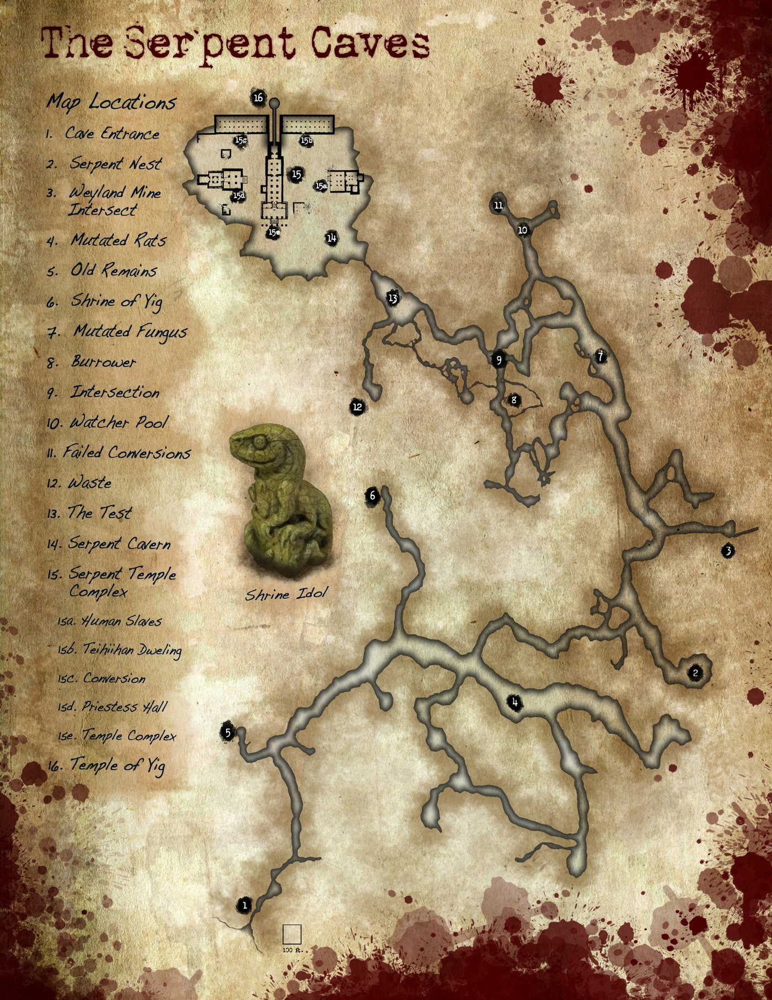

## Карта Змеиных пещер

**Места на карте**

1. Вход в пещеры
2. Змеиное гнездо
3. Пересечение с шахтой «Уэйленд»
4. Галерея крыс-мутантов
5. Старые останки
6. Святилище Йига
7. Грибной собор
8. Норы хтонийцев
9. Перекрёсток
10. Пруд наблюдателей
11. Неудавшиеся обращения
12. Сток нечистот
13. Испытание
14. Змеиная пещера
15. Комплекс Змеиного храма
    - 15a. Зал рабов
    - 15b. Жилище тейхиихан
    - 15c. Зал обращения
    - 15d. Зал жрицы
    - 15e. Храмовый комплекс
16. Храм Йига

Подпись у фотографии: Shrine Idol — идол из святилища.
