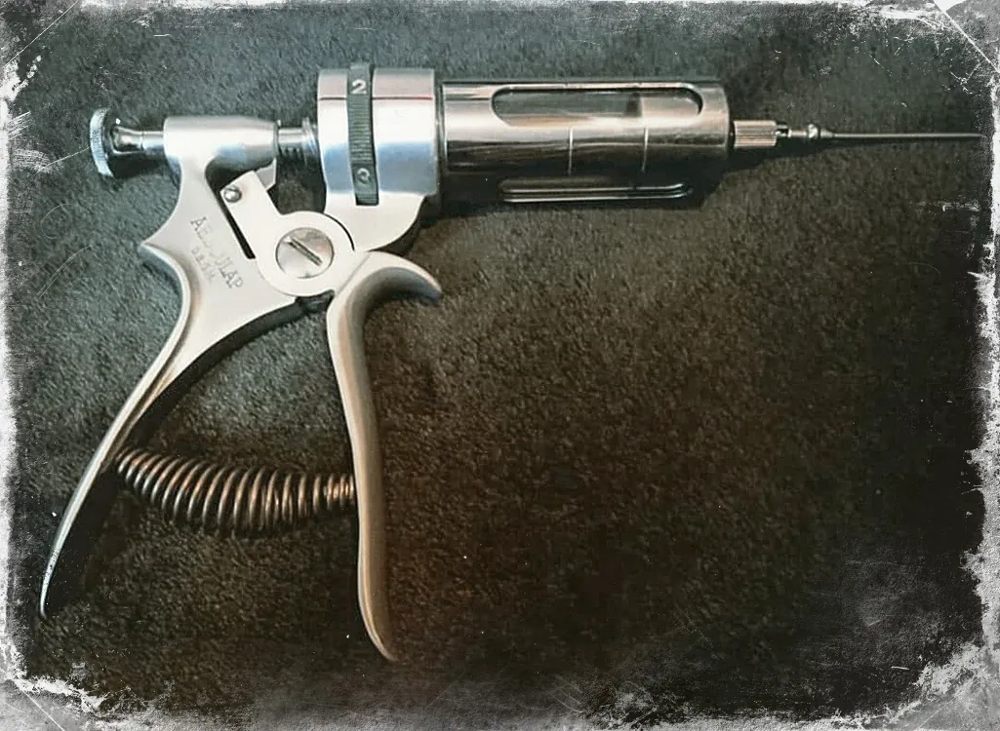

### Атака гарпуном

Дастбилли умудрились собрать из старых деталей грузовика — оси, металлолома и мощных листовых рессор — гарпунный самострел наподобие арбалета. Чтобы зарядить его, нужен целый боевой раунд, так что стрелять гарпуном можно раз в два раунда. Каждый гарпун привязан к 15-метровому буксирному тросу, который, в свою очередь, закреплён на раме пикапа.

```stat
Гарпунный самострел
Навык: Стрельба (арбалет)
Урон: 1d10+2
Базовая дальность: 15 м
Выстрелов за раунд: 1/2
Магазин: 1
Осечка: 95
```

## Несмертельные атаки

### Ружьё «бинбэг»

Это пневматическое оружие выстреливает в цель плотным мешочком с дробью, чтобы оглушить. Если в сыщика попали, он должен пройти трудную проверку ВЫН, иначе теряет сознание на 2d10 минут. Если на нём броня, снижающая урон до 0, сознания он не теряет.

```stat
Ружьё «бинбэг»
Навык: Стрельба (дробовик)
Урон: 1d4
Базовая дальность: 5 м
Выстрелов за раунд: 1
Магазин: 1
Осечка: 100
```

### Нокаут

Дастбилли будут пытаться усмирить сыщиков и кулаками, прикладами, топорищами и всем, что подвернётся под руку. Хранителю стоит пользоваться правилом «Нокаут» (с. 125 англ. издания «Книги хранителя»).

### Шест-петля

Это просто шест длиной 1,2–2 м с петлёй из верёвки или проволоки на конце, которую держащий легко затягивает. Чтобы накинуть петлю цели на шею, руку или ногу, нападающий должен выполнить боевой манёвр. Если такую попытку делают несколько нападающих, каждый получает бонусную кость. Успешный манёвр означает, что цель поймана. Пойманная жертва ограничена в движении: чтобы перемещаться, ей нужна встречная проверка СИЛ. Пока петля держит жертву, та не может ни приблизиться к человеку на другом конце шеста-петли, ни отдалиться от него.

Если петля на шее жертвы, ей трудно дышать. Через 3 раунда она должна каждый раунд проходить проверку ВЫН, чтобы не потерять сознание. Если она пытается двигаться с петлёй на шее, эта проверка проходит со штрафной костью.

Если поймана конечность, жертве придётся проходить встречную проверку СИЛ, чтобы пользоваться этой конечностью, и даже тогда у неё будет штрафная кость. Например, руку сыщика держит противник. В этой руке у сыщика пистолет, и он хочет выстрелить в определённую цель. Прежде чем атаковать Стрельбой, он должен пройти встречную проверку СИЛ, и сама атака будет со штрафной костью.

Если жертву удерживают два шеста-петли или больше, она фактически обездвижена. По усмотрению Хранителя, в зависимости от обстоятельств, она может вырваться чрезвычайной проверкой СИЛ.

В свой ход нападающий может выполнять боевые манёвры, чтобы заставить жертву бросить то, что она держит, или двигаться в определённом направлении. Если у союзника тоже накинут шест-петля на ту же жертву, у нападающего бонусная кость.

### Кожаная дубинка («сап»)

Эти обтянутые кожей дубинки особенно хороши, чтобы оглушить жертву. При ударе у жертвы штрафная кость на проверку ВЫН, чтобы не потерять сознание (см. «Нокаут» на с. 125 англ. издания «Книги хранителя»).

### Шприцы со снотворным

Доктор Бреннер снабдил дастбилли сильным снотворным. Некоторые из них, в том числе Сет, носят стальные ветеринарные шприцы. Они очень прочные и не разобьются, если их уронить. А ещё от укола такого шприца адски больно. В бою атака шприцем считается боевым манёвром (см. с. 105 англ. издания «Книги хранителя»).

Успешный манёвр означает, что цель получила дозу снотворного и должна пройти трудную проверку ВЫН. При успехе она одурманена, но в сознании и получает 2 штрафные кости ко всем действиям и проверкам. При провале она немедленно теряет сознание на 4d4 часа. От второй дозы жертва без всякой проверки теряет сознание на 6d4 часа.


